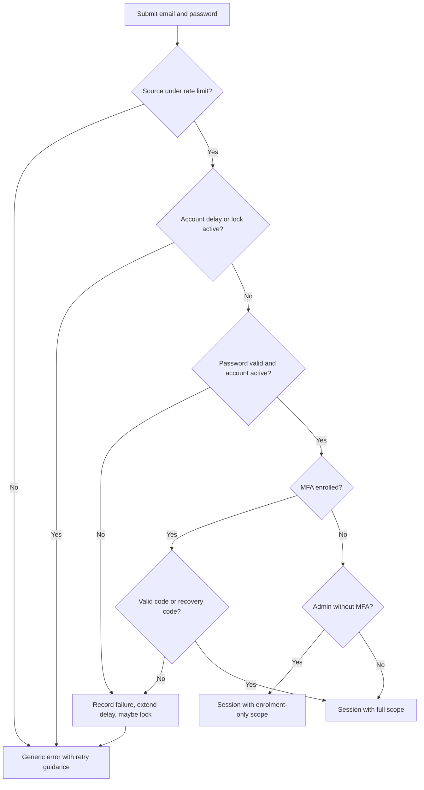

# U1 Foundation: Business Logic Model

Workflows for identity, administration, audit and the walking skeleton. Rules referenced as **BR-n** are defined in `business-rules.md`. Entities are in `domain-entities.md`. "Record audit" means one append-only audit entry is written in the same transaction as the change.

## W1 First-run setup (US-1.1)
1. A visitor opens a new instance. If no user exists, the setup screen is offered; otherwise it is unavailable and returns "not found" (BR-1.1).
2. The visitor enters display name, email and password (policy BR-2.x).
3. In one transaction: create the user with role `admin`, status `active`; record audit `auth.setup`.
4. Start an `AuthSession` with scope `mfa_enrolment_only` (BR-4.1).
5. Continue with W5 (MFA enrolment); no other screen is reachable until it completes.

## W2 Invite a user (US-1.3)
1. An admin enters email and role.
2. Validate: email format; not an existing user; not another pending invitation (BR-5.1).
3. Create the invitation (`pending`, expires in 7 days); generate a random token; store only its hash.
4. Show the full link to the admin **once** with a copy action and a "shown once" warning; no email is sent (BR-5.3).
5. Record audit `user.invited`.
6. The user list shows pending invitations with a revoke action; revoking sets `revoked` and records `user.invite_revoked`.

## W3 Accept an invitation (US-1.3, US-1.2)
1. The invitee opens the link. The token is looked up by hash. If it is unknown, expired, revoked or used, show one generic "This link is not valid" message (BR-5.4).
2. The invitee enters a display name and password (policy BR-2.x).
3. In one transaction: create the user with the invited role, mark the invitation `accepted`, record audit `user.invite_accepted`.
4. Start an `AuthSession`: scope `mfa_enrolment_only` if the role is `admin`, otherwise `full`. Admins continue with W5; members land on the home screen with an optional prompt to enrol.

## W4 Sign in (US-1.2, US-13.3)

Text alternative: check the per-source limit, then any account delay or lock; verify the password and that the account is active; if MFA is enrolled, require a valid code or unused recovery code; an admin without MFA gets an enrolment-only session; everyone else gets a full session. Every failure path returns the same generic message and feeds the account's failure counter.

Steps:
1. **Source limit**: more than 20 attempts per minute from one source are refused (BR-3.4).
2. **Delay and lock**: if the account's `delay_until` or `locked_until` is in the future, refuse with the generic message and a retry time (BR-3.1 to BR-3.3). The check runs even for unknown emails (with a shared dummy guard) so responses do not reveal whether an account exists.
3. **Credentials**: verify the password against the stored hash (a dummy hash is compared for unknown emails). A deactivated account fails the same way (BR-1.4).
4. **MFA step**: if the user has a confirmed MFA credential, the caller must supply a valid TOTP code (not reusing a time-step) or an unused recovery code (BR-4.4, BR-4.5). A wrong code counts as a failed attempt.
5. **Success**: reset the failure counter; create the `AuthSession` (cookie token shown once, stored hashed); set `last_sign_in_at`; record `auth.sign_in.success`.
6. **Failure**: increase the failure count, set the delay (BR-3.1), lock at the threshold (BR-3.2); record `auth.sign_in.failure` only when the email matches an account (BR-11.3); record `auth.sign_in.locked` when the lock starts.

## W5 Enrol in MFA (US-1.5)
1. The signed-in user starts enrolment; the system creates an unconfirmed `MfaCredential` with a new secret (sealed) and shows a QR code and the secret text.
2. The user enters a code from their authenticator. If valid, set `confirmed_at`.
3. Generate 10 recovery codes, store only their hashes, show them **once** with copy and download actions and a confirmation tick.
4. If the session had scope `mfa_enrolment_only`, upgrade it to `full`.
5. Record audit `auth.mfa.enrolled`.
6. Abandoning enrolment leaves no confirmed credential; an admin stays in `mfa_enrolment_only` scope (BR-4.1).

## W6 Use a recovery code (US-1.5)
1. At the MFA step the user chooses "Use a recovery code" and enters one.
2. If it matches an unused code, mark it used and complete sign-in; record audit `auth.mfa.recovery_used`.
3. When 3 or fewer unused codes remain, the home screen shows a reminder to generate a new set (generating replaces all previous codes).

## W7 Change my password (US-1.6)
1. The signed-in user enters the current password, the new password and a confirmation.
2. Validate: current password correct; new password meets policy (BR-2.x) and differs from the current one.
3. In one transaction: store the new hash, set `password_changed_at`, end every other `AuthSession` of this user (reason `password_changed`), record audit `auth.password.changed`.
4. The current session stays signed in.

## W8 Force a password reset (US-1.7)
1. An admin selects a user and chooses "Issue reset link", optionally ticking "Also reset MFA".
2. Create a `PasswordReset` (expires in 24 hours, `reset_mfa` per the tick); end all of the user's sessions (reason `reset_issued`); show the link once to the admin; record audit `auth.password.reset_issued`.
3. The user opens the link: an invalid, used or expired token shows the generic "not valid" message (BR-6.2).
4. The user sets a new password (policy). In one transaction: store the hash, mark the reset used, clear MFA if `reset_mfa`, record audit `auth.password.reset_completed`.
5. The user signs in normally. If MFA was cleared and the user is an admin, W4 gives an enrolment-only session until W5 completes.
6. A forgotten password has no self-service path in the MVP; the user asks an admin (BR-6.4).

## W9 Deactivate and reactivate a user (US-1.4)
- **Deactivate**: an admin confirms; reject if the user is the last active admin (BR-7.2). In one transaction set `status = deactivated`, end all of the user's sessions (reason `deactivated`), cancel their pending reset links, record audit `user.deactivated`. Their past content stays attributed to them.
- **Reactivate**: an admin confirms; set `status = active`, record audit `user.reactivated`. The user signs in again with their existing password and MFA (BR-7.4).

## W10 Change a user's role (US-1.8)
1. An admin picks a user and a new role.
2. Reject demoting the last active admin (BR-7.2); reject changing one's own role if that would leave zero admins.
3. Set the role; record audit `user.role_changed` (old and new).
4. Authority is read from the stored role on each request (BR-9.1), so a demoted admin loses access immediately. A promoted member must complete MFA enrolment before using admin screens: their next admin-area request puts the session into enrolment-only scope (BR-4.1).

## W11 Sign out and expiry (US-1.2)
- **Sign out**: end the current session (reason `signed_out`); clear the cookie.
- **Idle and absolute limits**: on each request compare `last_seen_at` with the idle timeout and `created_at` with the absolute duration, using the settings in force when the session was created (BR-8.2). If exceeded, end the session (`idle_timeout` or `absolute_timeout`) and require sign-in. Otherwise slide `last_seen_at`.

## W12 Change instance security settings (US-1.9)
1. An admin edits sign-in idle timeout, absolute duration and the online breach-check toggle.
2. Validate against the ranges in `domain-entities.md`; the absolute duration must be at least the idle timeout.
3. Save with `updated_by`; record audit `settings.changed` (key, old, new). New sign-ins use the new values; existing sign-ins keep theirs (BR-8.2).

## W13 Audit recording and viewing (US-2.7)
- **Record**: every state change in this document writes an audit entry in the same transaction; if the audit write fails, the change fails (BR-11.1).
- **View**: an admin opens the log, filters by user, event type and date range, and pages through newest first. No edit or delete control exists.
- **No pruning by the application**: entries are never edited or deleted by the running application (BR-11.2). Operators remove old entries only with a documented command and a privileged credential.

## W14 Authorise a request (all stories)
1. Resolve the session from the cookie; refuse if missing, ended or expired.
2. Load the user; refuse if deactivated.
3. If the session scope is `mfa_enrolment_only`, allow only MFA enrolment, sign-out and the current-user lookup.
4. Check the role against the permission matrix (BR-9.1); refuse with "not found" for admin-only resources when the caller is not an admin (BR-9.2).

## W15 Walking skeleton round trip (Q9 A)
1. A signed-in user creates a skeleton session (title) and opens it. They see only their own sessions.
2. The user posts a chat message. In one transaction: store the `ChatMessage` and write an `OutboxEvent` (`message.posted`).
3. The event is published: subscribers receive it over the WebSocket (the poster's other tabs see the message at once), and the decision step enqueues a `MockAgentReply` job.
4. A worker leases the job, asks the scripted mock provider for a reply (default `Received: ...`), and posts it as a `ChatMessage` with `author_kind = agent`, which writes its own outbox event.
5. The reply reaches the browser over the WebSocket. If the worker is down, the user message is still stored and shown; the reply arrives when the worker returns (jobs are durable).
6. This path is covered by the first end-to-end test and stays green through every later unit.

## Traceability: stories to workflows and rules

| Story | Workflows | Rule groups |
|---|---|---|
| US-1.1 First-run admin setup | W1, W5 | BR-1.1, BR-2, BR-4.1 |
| US-1.2 Sign in | W3, W4, W11, W14 | BR-1, BR-2, BR-3, BR-8 |
| US-1.3 Invite users | W2, W3 | BR-5, BR-9 |
| US-1.4 Deactivate and reactivate | W9 | BR-7 |
| US-1.5 MFA | W4, W5, W6 | BR-4 |
| US-1.6 Change my password | W7 | BR-2, BR-8.3 |
| US-1.7 Force a password reset | W8 | BR-6 |
| US-1.8 Change role | W10 | BR-7.2, BR-9 |
| US-1.9 Instance security settings | W12 | BR-8, BR-10 |
| US-2.7 Audit log | W13 | BR-11 |
| US-13.3 Sign-in lockout | W4 | BR-3 |
| US-13.7 Mobile, themes, WCAG | see `frontend-components.md` | BR-12 |
| (skeleton, no story completion) | W15 | BR-13 |
