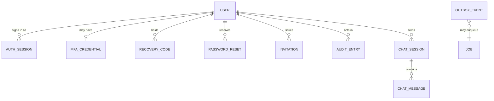

# U1 Foundation: Domain Entities

Technology-agnostic. Types are described in business terms; storage, hashing parameters and column types are decided in NFR Design and Code Generation. "Sealed" means encrypted at rest through the secret vault (C24); "hashed" means stored only as a one-way hash.

## 1. Entity relationship overview



Text alternative: a user has many logins (auth sessions), at most one MFA credential, many recovery codes, many password resets issued to them, and issues many invitations. Users appear as actors in audit entries and own skeleton sessions; a skeleton session contains messages. Outbox events may lead to jobs. Instance settings and audit entries stand alone (no foreign keys other than the actor reference).

## 2. Identity entities

### User
| Field | Meaning and rules |
|---|---|
| `id` | Stable identifier, never reused |
| `email` | Sign-in identifier; unique; compared case-insensitively; stored normalised (trimmed, lower-cased) |
| `display_name` | Shown to other members; 1 to 80 characters |
| `role` | `admin` or `member` |
| `status` | `active` or `deactivated` (see state machine) |
| `password_hash` | Hashed password; never exposed |
| `password_changed_at` | Used to end older logins |
| `created_at`, `created_via` | When and how: `first_run_setup` or `invitation` |
| `deactivated_at`, `deactivated_by` | Set while deactivated |
| `last_sign_in_at` | For the user list |

No avatar and no other profile fields in the MVP.

### Invitation
| Field | Meaning and rules |
|---|---|
| `id` | |
| `email` | Address the invite is for; must not match an existing user or another pending invitation |
| `role` | `admin` or `member`, applied when accepted |
| `token_hash` | The link token is shown once to the admin and stored only hashed |
| `created_by`, `created_at` | Issuing admin |
| `expires_at` | Creation plus 7 days |
| `status` | `pending`, `accepted`, `revoked`, `expired` |
| `accepted_user_id` | Set on acceptance |

### PasswordReset
| Field | Meaning and rules |
|---|---|
| `id`, `user_id` | The user the reset is for |
| `token_hash` | Link token, shown once to the admin |
| `created_by`, `created_at` | Issuing admin |
| `expires_at` | Creation plus 24 hours |
| `reset_mfa` | Whether using the link also clears the user's MFA |
| `used_at` | Set when consumed; a reset is single-use |

### AuthSession (a sign-in)
| Field | Meaning and rules |
|---|---|
| `id`, `user_id` | |
| `token_hash` | The cookie value is random and stored only hashed |
| `created_at`, `last_seen_at` | `last_seen_at` slides the idle timeout |
| `scope` | `full`, or `mfa_enrolment_only` for an admin who has not yet enrolled |
| `ended_at`, `ended_reason` | `signed_out`, `idle_timeout`, `absolute_timeout`, `password_changed`, `deactivated`, `reset_issued` |
| `source_summary` | Source network address and user-agent summary, for audit |

### MfaCredential
| Field | Meaning and rules |
|---|---|
| `user_id` | At most one per user |
| `secret_sealed` | TOTP secret, sealed |
| `confirmed_at` | Empty until the user proves the first valid code |
| `last_used_step` | Latest accepted time-step, to refuse code reuse |

### RecoveryCode
| Field | Meaning and rules |
|---|---|
| `id`, `user_id` | |
| `code_hash` | Hashed; shown in plain only once, at enrolment |
| `used_at` | Single-use |

### SignInGuard (per account) and SourceLimiter (per source)
| Field | Meaning and rules |
|---|---|
| `user_id` | Account being protected |
| `failure_count`, `window_started_at` | Failures counted over a rolling hour |
| `delay_until` | Earliest time the next attempt is accepted |
| `locked_until` | Set once the lockout threshold is reached |
| Source limiter | Counts attempts per source network address per minute; short-lived, not audited per attempt |

## 3. Settings and audit

### InstanceSetting
Key and value pairs edited by admins, with `updated_by` and `updated_at`. Settings defined in U1:

| Key | Default | Rule |
|---|---|---|
| `signin.idle_timeout` | 12 hours | Between 15 minutes and 30 days |
| `signin.absolute_duration` | 14 days | Between 1 hour and 90 days; at least the idle timeout |
| `password.online_breach_check` | off | On enables the online k-anonymity check in addition to the offline list |

### AuditEntry (append-only)
| Field | Meaning and rules |
|---|---|
| `id`, `occurred_at` | |
| `actor_id` | Nullable (for unauthenticated or system events) |
| `actor_label` | Snapshot of the actor's display name or `system` or `unknown source`, kept even if the user is later changed |
| `event_type` | From the catalogue in `business-rules.md` section 11 |
| `object_type`, `object_id` | What was affected (user, invitation, setting, and so on) |
| `outcome` | `success`, `failure` or `denied` |
| `details` | Structured, non-secret context (for example old and new role) |
| `request_id`, `source_summary` | For correlation |

Entries are never edited or deleted by the running application; the application's database role has no update or delete permission on this table. Operators prune only with a documented command and a privileged credential.

## 4. Walking-skeleton entities (replaced, not extended, by U3 and U4)

### ChatSession (skeleton)
| Field | Meaning |
|---|---|
| `id`, `title`, `owner_id`, `created_at` | Title 1 to 120 characters |
| `workspace_kind` | Always `managed_folder` in U1 |
| `state` | `active` |

Visible only to its owner in U1 (membership arrives in U3).

### ChatMessage (skeleton)
| Field | Meaning |
|---|---|
| `id`, `chat_session_id`, `created_at` | |
| `author_kind` | `user` or `agent` |
| `author_id` | User id, or the agent name (`mock-agent`) |
| `body` | Text, 1 to 4000 characters in U1 |

### OutboxEvent
| Field | Meaning |
|---|---|
| `id`, `type`, `payload`, `created_at` | Written in the same transaction as the change it describes |
| `published_at` | Empty until published to subscribers and to the job decision step |

### Job
| Field | Meaning |
|---|---|
| `id`, `kind`, `payload`, `run_at` | Skeleton kind: `MockAgentReply` |
| `status` | `queued`, `leased`, `done`, `failed` |
| `attempts`, `last_error` | Retry bookkeeping |

### MockModelScript
Configuration for the scripted mock model provider: a named script that maps an incoming message to a reply (default: `Received: <first 200 characters of the message>`). Used by the skeleton and by later tests (NFR-7.3).

## 5. State machines

### User status
```text
active --deactivate (admin)--> deactivated --reactivate (admin)--> active
```
Rules: a deactivated user cannot sign in; the last active admin cannot be deactivated or demoted.

### Invitation status
```text
pending --accepted--> accepted
pending --revoked (admin)--> revoked
pending --7 days pass--> expired
```
Terminal states are final; a new invitation is needed after `revoked` or `expired`.

### AuthSession
```text
active --sign out / idle / absolute / password change / deactivation / reset issued--> ended
```
A session with scope `mfa_enrolment_only` becomes scope `full` when the admin completes MFA enrolment.

### Job (skeleton)
```text
queued --lease--> leased --success--> done
leased --error, attempts left--> queued (later run_at)
leased --error, no attempts left--> failed
```
