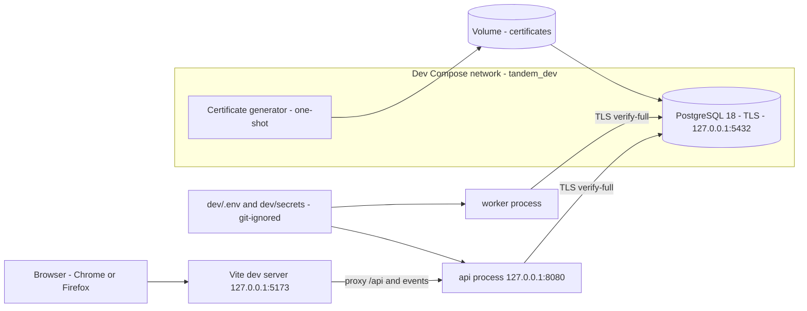
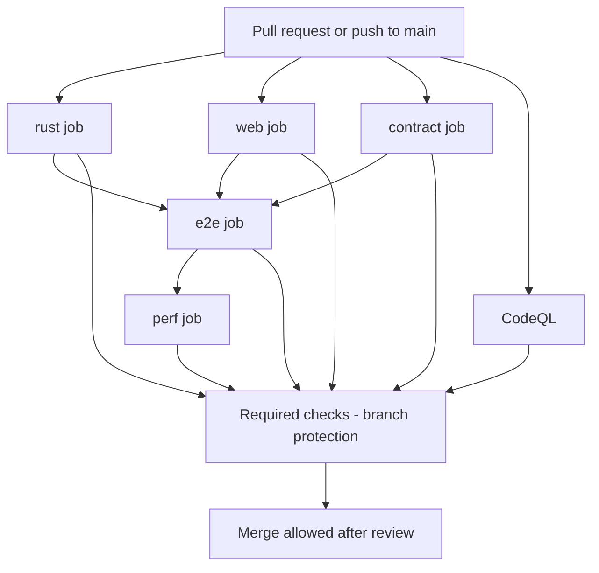

# U1 Foundation: Deployment Architecture

U1 has two "deployment" contexts: the developer machine and GitHub Actions CI. Operator-facing deployment (images, reference Compose, release) is designed and built in U8.

## 1. Developer environment

Text alternative: the browser talks only to the Vite dev server, which proxies API and event traffic to the native `api` process. `api` and `worker` connect to PostgreSQL over TLS with certificate verification. A one-shot generator writes the certificates into a volume that the database mounts; generated secrets in git-ignored files feed the apps.

| Item | Value |
|---|---|
| Ports | Vite 5173, `api` 8080 (both `127.0.0.1`), PostgreSQL 5432 on `127.0.0.1` |
| Public URL | `TANDEM_PUBLIC_URL=http://localhost:5173` |
| Processes | `api` and `worker` run natively through `just api` and `just worker`; they are separate processes from the first day, as in production |
| Data | Named volumes for PostgreSQL data and certificates; `just dev-reset` removes both |
| Secrets | Generated by `just dev-init`; never committed |

### 1.1 First-time setup
1. Install Docker (or Podman) and either enter the Nix dev shell or install the pinned Rust and Node versions.
2. `just dev-init` (generates secrets, creates certificates).
3. `just dev-up`, then `just migrate`.
4. `just api`, `just worker`, `just web` in separate terminals.
5. Open `http://localhost:5173`; the first-run setup screen appears.

### 1.2 Everyday loop
Edit code; the Rust processes restart on rebuild and Vite hot-reloads. `just check` runs everything CI will run; `just dev-reset` gives a clean database.

### 1.3 Failure cases
| Situation | Behaviour |
|---|---|
| Certificates missing or wrong | Apps refuse to start with one clear message (start-up guard) |
| Database not ready | `/readyz` returns 503; the apps retry connecting with backoff |
| Migration behind or ahead of the binary | Apps refuse to start (AV-3) |
| Port already in use | Configurable in `dev/.env`; the message names the variable |

## 2. CI pipeline

Text alternative: on every pull request the `rust`, `web`, `contract` and CodeQL jobs run in parallel; `e2e` runs after the first three succeed, and `perf` after `e2e`. Branch protection requires all of them plus a review before merging.

| Aspect | Design |
|---|---|
| Runner | GitHub-hosted `ubuntu-24.04`, Docker available for the throw-away PostgreSQL containers and the dev compose file |
| Permissions | Read-only default; CodeQL gets `security-events: write` on its own job only |
| Supply chain | Actions pinned by commit SHA; lock files; `cargo audit`, `cargo deny`, `npm audit`; Dependabot keeps pins current |
| Secrets in CI | None needed for U1; the end-to-end job generates throw-away secrets with the same `dev-init` logic |
| Artefacts | Test reports and Playwright traces on failure; OpenAPI diff on contract failure |
| Timeouts | Each job has an explicit timeout; superseded runs are cancelled |

## 3. What changes in U8 (not built now)
| Aspect | U1 | U8 |
|---|---|---|
| Artefacts | None published | `api` and `worker` images, signed, with an SBOM |
| Compose | Dev only, database only | Reference Compose with `api`, `worker`, PostgreSQL, optional SearXNG, migration one-shot, certificate generator reused |
| Network | Loopback bindings | One published entry point behind the operator's reverse proxy |
| Releases | None | Versioned releases, changelog, rollback by image version |
| Observability | `/metrics` read by hand | Example alert rules and dashboard definition |
| Backup | None | Backup and restore commands |
