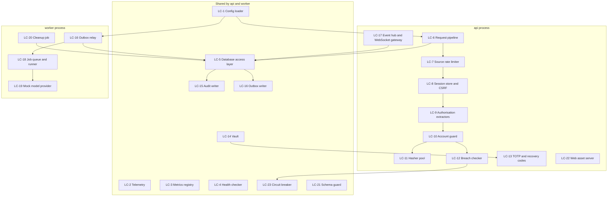

# U1 Foundation: Logical Components

The components Code Generation will build to realise the NFR design, with their responsibilities, interfaces, dependencies, configuration and metrics. They sit inside the Application Design components (C1 to C27) and the crate layout in `unit-of-work.md`. "Both" means shared by `api` and `worker`.

## 1. Component map

Text alternative: the request pipeline flows through the rate limiter and session store to the authorisation extractors; sign-in uses the account guard, which uses the hasher pool and the breach checker (behind a circuit breaker). Handlers use the database access layer, which writes audit entries and outbox rows in the same transaction. In the worker, the outbox relay feeds the job runner, which calls the mock provider; the cleanup job and the event hub also use the database. The config loader feeds both processes, and the vault feeds TOTP secret handling.

## 2. Component catalogue

### LC-1 Config loader (both)
- **Responsibility**: read environment variables and the optional TOML file (environment wins), accept secrets only from files or environment, validate everything at start-up, refuse to start on any problem, never print secrets.
- **Interface**: a typed `Config` produced once and passed down; no global mutable state.
- **Settings**: `TANDEM_PUBLIC_URL`, `TANDEM_DATABASE_URL`, `TANDEM_DATABASE_CA_FILE`, `TANDEM_MASTER_KEY_FILE`, `TANDEM_LISTEN_ADDR`, `TANDEM_TRUSTED_PROXIES`, `TANDEM_METRICS_TOKEN`, `TANDEM_OTLP_ENDPOINT`, `TANDEM_LOG_LEVEL`, `TANDEM_HASH_MEMORY_BUDGET_MB`, pool sizes and timeouts.
- **Failure**: start-up error with one message per problem.

### LC-2 Telemetry (both)
- **Responsibility**: JSON logging with request or job ID and trace ID; the redaction layer; optional OpenTelemetry export; the access log.
- **Interface**: `tracing` spans and events; a layer that strips fields named password, token, secret, code, cookie or authorization.
- **Metrics**: `log_events_total{level}`.

### LC-3 Metrics registry (both)
- **Responsibility**: register and expose all OB-1 metrics and the extra metrics named in the patterns document.
- **Interface**: counters, histograms and gauges by name; `GET /metrics` handler (bearer token, disabled without a token).
- **Failure**: metric errors never affect requests.

### LC-4 Health checker (both)
- **Responsibility**: `/healthz` (process up) and `/readyz` (database within 1 s, schema version, vault canary, relay lag for the worker); readiness false during shutdown.
- **Dependencies**: LC-5, LC-14, LC-21.

### LC-5 Database access layer (both)
- **Responsibility**: bounded pools (separate per process), acquire and statement timeouts, TLS with certificate verification, transaction helper (`with_transaction`) that guarantees rollback on error, repositories with parameterised queries only, advisory-lock helper.
- **Roles**: the app role at runtime; the migration role only inside LC-21.
- **Metrics**: `db_pool_connections{state}`, `db_query_duration_seconds`.

### LC-6 Request pipeline (api)
- **Responsibility**: the middleware chain in the order given in the patterns document, including request ID, panic catching and global error handling, security headers, body limit and routing; the start-up check that every route is public or declares an authorisation extractor.
- **Metrics**: `http_requests_total{route,status}`, `http_request_duration_seconds{route}`.

### LC-7 Source rate limiter (api)
- **Responsibility**: in-memory token buckets per source address (general, sign-in and token, setup); source address resolution honouring `TANDEM_TRUSTED_PROXIES`.
- **Interface**: `check(source, bucket) -> Allowed | Retry(after)`.
- **Failure**: bucket memory is bounded; on overflow the oldest entries are evicted.
- **Metrics**: `rate_limited_total{bucket}`.

### LC-8 Session store and CSRF guard (api)
- **Responsibility**: create sessions (cookie token, hashed storage, limits copied from settings at creation), resolve a session per request from PostgreSQL, throttle `last_seen_at` writes to once a minute, end sessions with a reason, issue and verify the per-session CSRF token and the Origin check.
- **Interface**: `create(user, scope)`, `resolve(cookie) -> SessionContext`, `end(session, reason)`, `end_all(user, reason)`, `verify_csrf(ctx, header)`.
- **Failure**: any doubt denies.

### LC-9 Authorisation extractors (api)
- **Responsibility**: the typed extractors `AnyUser`, `FullScopeUser`, `AdminUser` and the permission matrix (BR-9.3); returns "not found" for admin resources to non-admins; records `authz.denied` through LC-15.
- **Interface**: used in handler signatures only; no handler performs ad-hoc role checks.

### LC-10 Account guard (api)
- **Responsibility**: delay and lockout state per account in PostgreSQL (`FOR UPDATE`), bounded guard for unknown emails keyed by a hash of the normalised email, window and reset rules (BR-3).
- **Interface**: `before_attempt(email) -> Proceed | Wait(retry_at)`, `record_failure(email)`, `record_success(user)`.
- **Metrics**: `auth_sign_in_total{outcome}`, `auth_lockouts_total`.

### LC-11 Hasher pool (api)
- **Responsibility**: Argon2id hashing and verification on dedicated blocking threads, concurrency gate (cores and memory budget), first-start benchmark and stored profile, transparent rehash on sign-in when the stored parameters are outdated, dummy hash for unknown accounts.
- **Interface**: `hash(password) -> Hash`, `verify(password, hash) -> Verified { needs_rehash }`, `dummy_verify()`; load-shed error `Busy` after a 2-second wait.
- **Metrics**: `hash_inflight`, `hash_wait_seconds`, `hash_rejected_total`, `hash_duration_seconds`.

### LC-12 Breached-password checker (api)
- **Responsibility**: offline membership check against the bundled filter; optional online k-anonymity query (2-second timeout) guarded by LC-23; policy checks of BR-2.1 and BR-2.2.
- **Interface**: `check(password) -> Ok | Violation(kind)`.
- **Metrics**: `breach_check_degraded_total`, `breach_check_online_total{result}`.

### LC-13 TOTP and recovery codes (api)
- **Responsibility**: secret generation, `otpauth` URI, code verification with one-step tolerance and time-step replay guard (stored per user), recovery code generation, hashing and single-use consumption; sealing of the secret through LC-14.
- **Interface**: `start_enrolment(user)`, `confirm(user, code) -> RecoveryCodes`, `verify(user, code)`, `use_recovery(user, code)`, `regenerate(user)`.

### LC-14 Vault (both)
- **Responsibility**: AES-256-GCM envelope sealing with key ID, nonce and associated data; key file with current and decrypt-only keys; start-up canary; `rekey` operation used by the operations CLI.
- **Interface**: `seal(purpose, row_id, plaintext) -> Sealed`, `open(purpose, row_id, sealed) -> Plaintext`.
- **Failure**: wrong or missing key stops start-up; open errors are generic and logged without data.

### LC-15 Audit writer (both)
- **Responsibility**: insert audit entries inside the caller's transaction, enforce the event catalogue (BR-11.5), strip secrets from `details`, write `authz.denied` in a separate short transaction.
- **Interface**: `record(tx, AuditEvent)`; there is no update or delete method.
- **Failure**: an insert error fails the surrounding operation.

### LC-16 Outbox writer and relay (both writer; worker relay)
- **Responsibility**: write an outbox row (event type, payload, trace context) inside the change's transaction and issue `NOTIFY` on commit; the relay holds an advisory lock, reads unpublished rows in order in batches of 100, runs the decision step (enqueue jobs) and marks rows published.
- **Interface**: `emit(tx, Event)`, relay loop (supervised).
- **Metrics**: `outbox_pending`, `outbox_relay_lag_seconds`.

### LC-17 Event hub and WebSocket gateway (api)
- **Responsibility**: one `LISTEN` connection per process; read new outbox rows by ID on wake-up and on a 1-second poll; push those visible to each connected user; connection limits (10 per user), Origin check, session check, 25-second pings, bounded outbound queues with disconnect on overflow; replay from the client's last event ID within 24 hours, otherwise "resync".
- **Metrics**: `ws_connections`, `ws_dropped_slow_total`, `ws_resync_total`.

### LC-18 Job queue and runner (worker; enqueue from both)
- **Responsibility**: enqueue, lease with `SKIP LOCKED`, heartbeat, complete, fail with retry delays 5 s, 30 s, 2 min, mark `failed` after three attempts; supervised loop; trace context propagation.
- **Interface**: `enqueue(tx, Job)`, `lease(kinds)`, `heartbeat`, `complete`, `fail`.
- **Metrics**: `job_queue_depth{kind}`, `job_oldest_age_seconds`, `job_duration_seconds{kind}`, `job_failed_total{kind}`.

### LC-19 Mock model provider (worker, tests)
- **Responsibility**: deterministic scripted replies behind the `ModelProvider` port, used by the skeleton and later tests; default reply `Received: <first 200 characters>`.

### LC-20 Cleanup job (worker)
- **Responsibility**: daily deletion of ended sessions and used or expired tokens older than 30 days, finished jobs older than 30 days, published outbox rows older than 24 hours. Never touches the audit table.
- **Metrics**: `cleanup_deleted_total{table}`.

### LC-21 Schema guard and migration tool (both; CLI)
- **Responsibility**: reversible versioned migrations run by `tandem migrate up|down` under the migration role and an advisory lock; start-up check that the schema version matches the binary.
- **Failure**: mismatch refuses to start with a clear message.

### LC-22 Web asset server (api)
- **Responsibility**: serve the built web client with content-hashed immutable assets, no-cache `index.html`, the security headers, no directory listing, client entry fallback for non-API routes.

### LC-23 Circuit breaker (both)
- **Responsibility**: generic breaker used by outbound calls: opens after 5 consecutive failures or when half of the last 20 calls failed; open for 30 s; one trial call when half-open.
- **Metrics**: `breaker_state{name}`, `breaker_trips_total{name}`.

## 3. Infrastructure elements (dev-only in U1; packaged in U8)
| Element | Role |
|---|---|
| PostgreSQL with TLS | One database, two roles (migration, app), `hostssl` only; audit table grants as in the patterns document |
| Certificate generator (one-shot) | Creates a private CA and server certificate into a shared volume for the development compose file; reused by the reference Compose file in U8 |
| Migration one-shot | Runs `tandem migrate up` before the services start |
| Internal network | Only `api` is reachable from outside the container network (SE-8); decided in detail in Infrastructure Design |

## 4. Ownership by story
| Story | Main logical components |
|---|---|
| US-1.1, US-1.2, US-1.3, US-1.6, US-1.7 | LC-8, LC-9, LC-10, LC-11, LC-12, LC-15 |
| US-1.4, US-1.8, US-1.9 | LC-9, LC-15, LC-8 (session end) |
| US-1.5 | LC-13, LC-14 |
| US-2.7 | LC-15, LC-5 |
| US-13.3 | LC-7, LC-10, LC-11 |
| US-13.7 | LC-22 (and the web client) |
| Skeleton round trip | LC-16, LC-17, LC-18, LC-19 |
| Cross-cutting | LC-1 to LC-6, LC-14, LC-20, LC-21, LC-23 |
