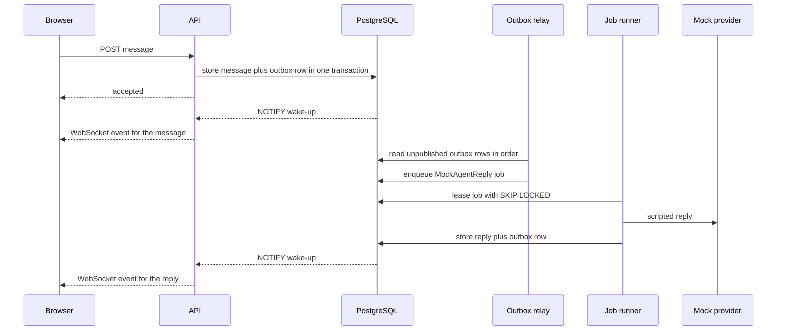

# U1 Foundation: NFR Design Patterns

Concrete patterns, parameters and failure behaviour that satisfy the approved NFRs. Parameter values are defaults; each is a named setting in the configuration loader (LC-1). Component names (LC-n) refer to `logical-components.md`. Rule references are to `business-rules.md` (BR) and `nfr-requirements.md` (SC, PF, AV, RL, SE, OB, MT).

## 1. Request pipeline (security and resilience in layers)

```mermaid
flowchart LR
    Req["Incoming request"]
    Id["Request ID"]
    Log["Access log"]
    Err["Panic catcher and global error handler"]
    Hdr["Security headers"]
    Lim["Per-source rate limit"]
    Body["Body size limit"]
    Ses["Session resolution"]
    Csrf["CSRF check"]
    Auth["Typed authorisation extractor"]
    Hdl["Handler and transaction"]

    Req --> Id --> Log --> Err --> Hdr --> Lim --> Body --> Ses --> Csrf --> Auth --> Hdl
```

Text alternative: every request passes in order through request ID, access log, panic catcher and global error handler, security headers, per-source rate limit, body size limit, session resolution, CSRF check, a typed authorisation extractor in the handler, and then the handler inside a transaction. Public routes skip session resolution and CSRF but keep every other layer.

| Layer | Behaviour | Fails as |
|---|---|---|
| Request ID | Reuses a valid incoming ID from a trusted proxy, otherwise generates one; returned in the `X-Request-Id` header and in every log line (SE-4) | Never fails |
| Access log | One JSON line per request: method, route template (not the raw path), status, duration, user ID, request ID (SE-3) | Logging failure never blocks the response |
| Panic catcher and global error handler | Converts panics and unhandled errors into a generic 500 with the request ID; details go to the log only (RL-3, SE-16) | Generic error, fail closed |
| Security headers | Adds the headers in section 7 to every response | Never fails |
| Per-source rate limit | Token bucket per source address held in memory per `api` process: 300 requests per minute by default, 20 per minute for sign-in and token endpoints, 10 per minute for first-run setup; returns 429 with `Retry-After` and the generic wording from BR-3.6 (Q1 A) | 429 |
| Body size limit | 1 MB default, rejected before parsing (SE-6) | 413 |
| Session resolution | Reads the cookie, hashes it, loads session, user, role, status and scope from PostgreSQL on **every** request (Q2 A); rejects ended, expired, deactivated or missing; updates `last_seen_at` at most once per minute | 401, or redirect to sign-in |
| CSRF check | For POST, PUT, PATCH and DELETE, requires the `X-CSRF-Token` header to equal the session's token in constant time; also checks the `Origin` header equals `TANDEM_PUBLIC_URL` | 403 generic |
| Authorisation extractor | `AnyUser`, `FullScopeUser` or `AdminUser` declared in each handler's signature; `AdminUser` returns "not found" to non-admins (BR-9.2); a start-up check fails if any route is neither public nor declares an extractor | 404 or 403 |
| Handler and transaction | One transaction per state change, with the audit entry and outbox event written inside it (BR-11.1) | Rolled back, generic error |

## 2. Resilience patterns

| Pattern | Design | NFR |
|---|---|---|
| **Timeouts everywhere** | HTTP: 10 s to read headers, 30 s per request. Database: 2 s to acquire a connection, statement timeout 5 s for requests and 30 s for jobs. Online breach check: 2 s. WebSocket: ping every 25 s, drop after two missed pongs | RL-1 |
| **Circuit breaker** (LC-23) on the online breach check | Opens after 5 consecutive failures or when at least half of the last 20 calls failed; stays open 30 s, then allows one trial call; while open, the offline filter alone decides and a warning is logged and counted (`breach_check_degraded_total`) | RL-2 |
| **Bulkheads** | Separate PostgreSQL pools for `api` and `worker`, each with a maximum size (default 10 and 5) so a job storm cannot starve requests; the hasher pool is its own bounded resource (section 4) | SC-4 |
| **Transactional outbox** | The state change, audit entry and outbox row commit together; a relay publishes afterwards. A crash between commit and publish loses nothing: the relay finds the unpublished row on restart | RL-5 |
| **Idempotent consumers** | Each consumer records the highest event ID it has handled (or uses the event ID as an idempotency key), so duplicate delivery never produces a second effect, for example a second mock agent reply | RL-5, BR-13.4 |
| **Retry with backoff** | Jobs retry after 5 s, 30 s and 2 min (3 attempts) then become `failed`; the user's message is never lost | RL-5, BR-13.3 |
| **Supervised background loops** | The outbox relay, job runner and cleanup run as supervised tasks: a panic or error is logged and the loop restarts with backoff (1 s doubling to 30 s) | RL-3 |
| **Fail closed** | Any error in authentication, authorisation, CSRF, rate limiting or audit writing denies the request; none falls back to allowing it | SE-16 |
| **Graceful shutdown** | On SIGTERM: readiness turns false at once; the server stops accepting connections; in-flight requests and the current job get up to 30 s; WebSockets receive a close frame; pools close; exit. Unfinished jobs keep their lease and are re-leased after expiry | AV-2 |
| **Start-up guard** | Refuses to start if the schema version is not the one the binary expects, if the database URL does not demand TLS, or if the vault key cannot unseal its canary value | AV-3, SE-1 |

## 3. Scalability and performance patterns

| Pattern | Design | NFR |
|---|---|---|
| **Stateless `api`** | No in-process state is required for correctness: sessions, guards, tokens and settings are in PostgreSQL. The only in-memory state is the per-source limiter (Q1 A), which is allowed to be per instance, and WebSocket connections | SC-2 |
| **Queue with `SKIP LOCKED`** | Workers lease jobs with `FOR UPDATE SKIP LOCKED`; leases last 60 s and are renewed by heartbeat; an expired lease returns the job to the queue | SC-3 |
| **Wake-up by `NOTIFY`, correctness by rows** | Committing a change that writes an outbox row also issues `NOTIFY` so listeners wake immediately; listeners also poll every 1 s, so a lost notification only adds latency | PF-3 |
| **Indexes on every hot path** | Unique index on normalised email; on session token hash; on invitation and reset token hashes; on audit entries by time, actor and type; on outbox by ID and published flag; on jobs by status and run time | PF-5 |
| **Lean session reads** | One query joins session and user; `last_seen_at` is updated at most once a minute to avoid a write per request | PF-1 |
| **No cache for security state** | No cache of sessions, roles or status (Q2 A) so changes apply immediately; non-security reads (for example the settings row) may be cached for 5 s | BR-9.1 |
| **Performance smoke test** | CI runs a short load against sign-in, a typical read, and the skeleton round trip with a seeded database and fails on regressions beyond the targets | PF-6 |

## 4. Password hashing under load (Q1 C of NFR Requirements, Q4 A)

- **Benchmark at first start**: tries Argon2id profiles (parallelism 1, iterations 2 to 4, memory 19 MiB up to 256 MiB) and picks the first that takes about 250 ms on this host, never below the minimum profile (19 MiB, 2 iterations). The chosen profile is stored as an internal setting (`password.hash_profile`) so later starts reuse it and logged once.
- **Per-hash parameters**: every stored hash records its own parameters (the standard encoded form). On a successful sign-in, a hash made with an older profile is silently rehashed with the current one, so raising the profile later needs no password resets.
- **Bounded concurrency**: a hashing gate allows at most `min(CPU cores, memory budget ÷ memory per hash)` hashes at once (memory budget default 512 MiB, setting `TANDEM_HASH_MEMORY_BUDGET_MB`). Hashing runs on dedicated blocking threads, not on the async runtime.
- **Load shedding**: an attempt waits for a slot for up to 2 seconds; if none frees up it returns a generic "busy, try again" answer without counting as a failed sign-in. Metrics: `hash_inflight`, `hash_wait_seconds`, `hash_rejected_total`.
- **Equal work for unknown accounts**: unknown emails run a dummy hash with the same profile through the same gate, so timing and capacity are the same (BR-3.5).

## 5. Security patterns

### 5.1 Sessions and CSRF
- Cookie `__Host-tandem_session`: `Secure`, `HttpOnly`, `SameSite=Lax`, `Path=/`, no `Domain`; value is 256 random bits; only its SHA-256 hash is stored (BR-8.1).
- A CSRF token (random, per session) is returned by `GET /auth/me`, held in memory by the client, and sent as `X-CSRF-Token` on state-changing calls. Safe methods never change state.
- Idle and absolute limits are stored on the session row when it is created (BR-8.2). Sign-out, password change, deactivation, forced reset and MFA reset end sessions by setting `ended_at` in the same transaction as the change.

### 5.2 Account guard (sign-in protection)
- One row per account holds `failure_count`, `window_started_at`, `delay_until`, `locked_until`. A sign-in attempt first reads the row with `FOR UPDATE` in a short transaction, so two simultaneous attempts cannot both pass inside one delay.
- Delay after the n-th failure in the rolling hour is min(2^(n-1), 60) seconds; the 10th failure sets `locked_until` 15 minutes ahead; success or an hour without failures resets the row (BR-3).
- Unknown emails use the same logic against a bounded, expiring guard table keyed by a hash of the normalised email (so nothing readable is stored), capped at a fixed size with oldest-first eviction.
- Lock starts write `auth.sign_in.locked`; failures for known accounts write `auth.sign_in.failure` (BR-11.3). Counters feed `auth_sign_in_total{outcome}` and `auth_lockouts_total`.

### 5.3 Vault envelope (SE-2)
- Algorithm AES-256-GCM, 96-bit random nonce per value, associated data = purpose plus row ID, so a sealed value cannot be moved to another row.
- Stored form: key ID, nonce, ciphertext and tag. The key file holds several keys, each with an ID and a status (`current` or `decrypt-only`); new values use `current`.
- `tandem vault rekey` re-seals all values under the current key; the old key can then be removed. A canary value is checked at start-up so a wrong or missing key fails fast.

### 5.4 Database roles and TLS (SE-1, SE-7)
- **Migration role**: owns the schema, runs migrations only, never used by running services.
- **App role**: `SELECT`, `INSERT`, `UPDATE`, `DELETE` on application tables, **except the audit table where it has `INSERT` and `SELECT` only**; no schema changes, no superuser, no other schemas. Both services use this role with separate pools.
- All connections use TLS 1.2+ with certificate verification (`verify-full`). The reference Compose file runs a one-shot certificate generator that creates a private CA and server certificate in a volume shared read-only with the database and the services; operators can replace them. The database accepts only `hostssl` connections.

### 5.5 Audit writer (SE-15)
- The audit entry is inserted inside the same transaction as the change; if the insert fails, the change rolls back (BR-11.1).
- `authz.denied` entries are written in their own short transaction (the request transaction is not committed); if that write fails the request still fails closed and the failure is logged.
- No code path in the running application issues an update or delete on audit rows, and the app role could not succeed if it tried.

### 5.6 Log redaction (SE-4)
- A logging layer removes any field whose name contains `password`, `token`, `secret`, `code`, `cookie` or `authorization` and masks sealed values; request and response bodies are never logged; actors are identified by user ID, not email; unknown emails are never logged.

### 5.7 Metrics exposure (SE-10, Q3 B)
- `GET /metrics` is served on the main port and requires `Authorization: Bearer <token>` compared in constant time. The token comes from `TANDEM_METRICS_TOKEN` or its `_FILE` variant. **If no token is configured the endpoint returns "not found"** (deny by default). The self-hosting guide tells operators to block `/metrics` at their reverse proxy as well.

### 5.8 Proxy and source address (D16)
- The source address is the direct peer unless it is inside `TANDEM_TRUSTED_PROXIES`, in which case the right-most untrusted entry of `X-Forwarded-For` is used. This feeds rate limiting and audit entries. With no trusted proxies configured, forwarded headers are ignored.

## 6. Eventing, real-time and job patterns

Text alternative: the browser posts a message; the API stores it and an outbox row in one transaction and replies. A notification wakes the API, which pushes the message to the browser over the WebSocket. The relay reads the outbox in order and enqueues a mock-agent job; the job runner leases it, gets the scripted reply, and stores the reply with its own outbox row; a notification makes the API push the reply to the browser.

- **Outbox relay**: exactly one relay is active at a time, chosen by a PostgreSQL advisory lock, so order is preserved even with several workers. It reads rows in ID order in batches of 100, performs the decision step (enqueue jobs), and marks rows published.
- **Event fan-out**: each `api` process holds one `LISTEN` connection; on wake-up it reads new outbox rows by ID and pushes those visible to each connected user (in U1: the owner of the skeleton session).
- **WebSocket**: authenticated by the session cookie and an Origin check; at most 10 connections per user; each connection has a bounded outbound queue, and a client that cannot keep up is disconnected and must resync.
- **Catch-up (Q5 A)**: on reconnect the client sends its last event ID; the server replays later events it is allowed to see from the outbox; if the requested ID is older than the 24-hour outbox retention, the server answers "resync" and the client reloads its view.
- **Job runner**: `SELECT ... FOR UPDATE SKIP LOCKED` lease, 60 s with heartbeat, retry delays 5 s, 30 s, 2 min, three attempts, then `failed`. Trace context in the job record links the worker's span to the originating request (OB-2).
- **Cleanup job** (daily, supervised): deletes ended sessions and used or expired tokens older than 30 days, finished jobs older than 30 days, and published outbox rows older than 24 hours. It never touches the audit table (Q6 A, Q2 B).

## 7. Security headers and static assets (SE-5, SE-14)
- `Content-Security-Policy: default-src 'self'; script-src 'self'; style-src 'self'; img-src 'self' data:; connect-src 'self' <wss form of TANDEM_PUBLIC_URL>; font-src 'self'; frame-ancestors 'none'; base-uri 'none'; form-action 'self'; object-src 'none'`. No `unsafe-inline` and no `unsafe-eval`; `img-src data:` exists only for the QR code.
- `Strict-Transport-Security: max-age=31536000; includeSubDomains`, `X-Content-Type-Options: nosniff`, `X-Frame-Options: DENY`, `Referrer-Policy: strict-origin-when-cross-origin`.
- Static assets are content-hashed and served `immutable`; `index.html` is served `no-cache`; no directory listing; unknown paths return the client entry page only for non-API routes.
- CORS is not enabled: cross-origin requests are not answered with CORS headers.

## 8. Observability patterns (OB-1 to OB-4)
- **Metrics registry** (LC-3): all OB-1 metrics, plus `hash_*`, `breach_check_degraded_total`, `outbox_pending`, `outbox_relay_lag_seconds`, `job_*`, `ws_connections`, `db_pool_*`, `build_info`.
- **Logs**: JSON to standard output; fields `ts`, `level`, `target`, `request_id` or `job_id`, `trace_id`, `user_id`, `msg` and structured fields.
- **Traces**: spans for the request, each database call, each job; context stored in the outbox row and job; exported over OTLP only when `TANDEM_OTLP_ENDPOINT` is set.
- **Health**: `/healthz` returns 200 if the process is up. `/readyz` returns 200 only if the database answers within 1 s, the schema version matches, the vault canary unseals, and (for the worker) the relay lag is under 30 s; it returns 503 during shutdown.
- **Example alerts and dashboard** are written in U8 from these metrics (SECURITY-14, OB-3).

## 9. Configuration and operations patterns (Q7 A)
- Settings come from environment variables (prefix `TANDEM_`), then an optional TOML file named by `TANDEM_CONFIG`; **the environment wins**; defaults apply last. Secrets are accepted only as files (`*_FILE`) or environment variables, never in the TOML file; the loader rejects a secret found in the file.
- Required: `TANDEM_PUBLIC_URL`, `TANDEM_DATABASE_URL` (or `_FILE`) demanding TLS, `TANDEM_DATABASE_CA_FILE`, `TANDEM_MASTER_KEY_FILE` (or variable). Optional: `TANDEM_LISTEN_ADDR`, `TANDEM_TRUSTED_PROXIES`, `TANDEM_METRICS_TOKEN`, `TANDEM_OTLP_ENDPOINT`, `TANDEM_LOG_LEVEL`, `TANDEM_HASH_MEMORY_BUDGET_MB`, pool sizes.
- The loader validates everything at start-up and prints one clear error per problem; it never prints secret values.
- Migrations are run only by `tandem migrate up|down` under the migration role and an advisory lock; the Compose file runs it as a one-shot service before `api` and `worker` (D13).

## 10. Testability hooks (MT-2, MT-6)
- A clock abstraction and a deterministic random source for tokens and codes let tests control time (expiry, lockout windows, TOTP steps) without sleeping.
- The mock model provider is scripted and deterministic.
- Each pattern above has a test that provokes its failure: provider down (breaker opens), worker killed mid-job (lease expires and the job retries), duplicate event delivery (no second reply), flood of sign-ins (load shed), tampered CSRF token, stale session after demotion.

## 11. Traceability: NFR requirement to pattern and component

| NFR | Pattern (section) | Component |
|---|---|---|
| SC-1, SC-2 | 3 Stateless `api` | LC-6, LC-8 |
| SC-3 | 3 Queue with `SKIP LOCKED`; 6 Job runner | LC-18 |
| SC-4 | 2 Bulkheads | LC-5, LC-11 |
| PF-1 to PF-3, PF-5, PF-6 | 3 | LC-5, LC-6, LC-8, LC-16, LC-17 |
| PF-4 | 4 | LC-11 |
| AV-1 | 8 Health | LC-4 |
| AV-2 | 2 Graceful shutdown | LC-6, LC-18 |
| AV-3, AV-4 | 2 Start-up guard; 9 Migrations | LC-21 |
| RL-1 | 2 Timeouts | LC-5, LC-12, LC-17 |
| RL-2 | 2 Circuit breaker | LC-12, LC-23 |
| RL-3, RL-4, SE-16 | 1 Panic catcher; 2 Fail closed | LC-6 |
| RL-5 | 2 Outbox, idempotent consumers, retry; 6 | LC-16, LC-18 |
| RL-6 | 5.5 Audit writer | LC-15 |
| SE-1 | 5.4 TLS | LC-5, infrastructure |
| SE-2 | 5.3 Vault | LC-14 |
| SE-3, SE-4 | 1 Access log; 5.6 Redaction | LC-2 |
| SE-5 | 7 Headers | LC-6, LC-22 |
| SE-6 | 1 Body limit, typed validation | LC-6 |
| SE-7 | 5.4 Roles | LC-5, LC-21 |
| SE-8 | Infrastructure Design (Compose network) | infrastructure |
| SE-9 | 1 Session, CSRF, extractors; 5.1 | LC-8, LC-9 |
| SE-10 | 5.7 Metrics exposure; 7 | LC-3, LC-22 |
| SE-11 | CI (tech-stack-decisions) | CI |
| SE-12 | 1 Rate limit; 5.2; misuse tests | LC-7, LC-10 |
| SE-13 | 4 Hashing; 5.1; 5.2 | LC-8, LC-10, LC-11, LC-12, LC-13 |
| SE-14 | 7; typed deserialisation; CI branch protection | LC-6 |
| SE-15 | 5.5; 6 Cleanup excludes audit | LC-15, LC-20 |
| OB-1 to OB-4 | 8 | LC-2, LC-3, LC-4 |
| MT-1 to MT-8 | 10 Testability hooks; CI | all |
