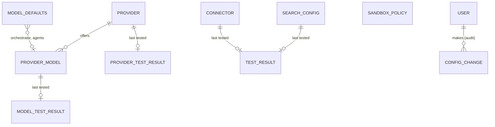

# U2 Instance Administration: Domain Entities

Technology-agnostic. "Sealed" means encrypted at rest through the secret vault under a purpose and bound to its row (U1 BR-4 vault rules). Every entity here belongs to the **instance** and is edited only by admins.

## 1. Overview

Text alternative: a provider offers several models and has one stored last-test result, as does each model. The default-models record points at up to two models, one for the orchestrator and one for thread and task agents. Search settings (one row per search kind, one of them active), the GitHub connector and the sandbox policy each stand alone; the first two keep a last-test result. Every change is an audit entry attributed to the admin who made it.

## 2. Providers and models (US-2.1, US-2.3)

### Provider
| Field | Meaning and rules |
|---|---|
| `id` | Stable identifier |
| `kind` | `openai_compatible` (extensible: `anthropic` in U8, `agent_sdk` in U9) |
| `name` | Shown to admins and owners; 1 to 60 characters; unique, compared case-insensitively |
| `base_url` | Full base URL including any `/v1` (BR-19) |
| `api_key` | Optional, sealed. Local servers such as Ollama need none |
| `key_saved_at` | When a key was last saved; the only thing shown about the key (BR-20) |
| `created_at`, `created_by`, `updated_at`, `updated_by` | Audit facts |

### ProviderModel
| Field | Meaning and rules |
|---|---|
| `id` | Stable identifier (default models point here, so renaming a model name does not break them) |
| `provider_id` | Owning provider; removed with it |
| `model_name` | The identifier the provider's API expects; 1 to 200 characters; unique within the provider |
| `label` | Optional friendly name |
| `tool_calling` | `supported`, `unsupported` or `unknown`, with `source` `detected` or `declared` |
| `context_tokens` | Whole number or unknown, with `source` `detected` or `declared` (BR-14.5) |

### TestResult (shared shape; stored last result only, BR-14.6)
| Field | Meaning |
|---|---|
| `status` | `ok`, `unreachable`, `timeout`, `unauthorised`, `unknown_model`, `bad_response`, `refused_address`, `not_configured` |
| `message` | Safe, specific text for the admin; never a response body, key or prompt |
| `tested_at`, `tested_by` | When and by whom |
| `details` | Small structured facts: for a model, detected capabilities; for GitHub, account login, token expiry when reported and the reachable repository count; for the container runtime, name and version |

A provider test produces one provider-level result (reachability and authorisation) and one model-level result per listed model.

## 3. Default models (US-2.4)

### ModelDefaults (single record)
| Field | Meaning and rules |
|---|---|
| `orchestrator_model_id` | Optional pointer to a ProviderModel |
| `agent_model_id` | Optional pointer to a ProviderModel, for thread and task agents |
| `updated_at`, `updated_by` | Audit facts |

A pointer is cleared automatically when its model or provider is removed (BR-15.3). New sessions read these as their starting choice; existing sessions keep what they chose (BR-15.4).

### CapabilityRequirement (code constant, not stored)
A model is **suitable** for the orchestrator and for agents when `tool_calling = supported` and `context_tokens >= 8,000` (A7). Anything else produces a warning where the default is chosen.

## 4. Search (US-2.5)

### SearchConfig (one record per kind)
| Field | Meaning and rules |
|---|---|
| `kind` | `searxng`, `brave` or `tavily` |
| `base_url` | SearXNG only; defaults to the bundled optional service address; other kinds use a fixed, built-in endpoint |
| `api_key` | Brave and Tavily; sealed; `key_saved_at` shown |
| `updated_at`, `updated_by` | Audit facts |

### ActiveSearch (single value)
`active_kind`: one of the three or none. Exactly zero or one provider is active (BR-16.1).

## 5. Connector (US-2.6)

### Connector
| Field | Meaning and rules |
|---|---|
| `kind` | `github` (the only connector in U2; the interface admits others, FR-12.1) |
| `auth_kind` | `token` (a fine-grained personal access token). `app` arrives in U5 as US-2.13 |
| `secret` | The token, sealed; `secret_saved_at` shown |
| `account_login` | Filled by a successful test (the account the token belongs to) |
| `token_expires_at` | Filled from GitHub's response header when it reports one |
| `updated_at`, `updated_by` | Audit facts |

The list of reachable repositories is fetched on demand for display and is **not stored**.

## 6. Sandbox policy (US-2.9)

### SandboxPolicy (one record per scope; `instance` is the only scope in the MVP, `session` is reserved, FR-16.6)
| Field | Meaning and rules |
|---|---|
| `scope` | `instance` |
| `runner_tier` | `in_process` or `container` (BR-18.2) |
| `tool_allow_list` | A set of tool identifiers from the registry (A1); `command_run` can never be in it (BR-18.3) |
| `network` | `none` (default) or `allow_hosts` with a list of host names (BR-18.4) |
| `limits.wall_clock_seconds` | Per run (A2) |
| `limits.max_output_bytes` | Per run |
| `limits.max_file_bytes` | Largest single file a run may write |
| `limits.max_files_written` | Number of files a run may create or change |
| `limits.memory_mebibytes`, `limits.cpu_millicores` | Container runner only (enforced from U7) |
| `updated_at`, `updated_by` | Audit facts |

Concrete file paths are never part of the policy; they come from each session's grants (US-3.2, US-6.9).

## 7. Audit additions (BR-21)
New event types: `config.provider.created`, `config.provider.updated`, `config.provider.deleted`, `config.defaults.updated`, `config.search.updated`, `config.connector.updated`, `config.sandbox_policy.updated`, `config.test.run`. Entry fields are the U1 audit entry fields; `details` carries before and after values with every secret shown only as `set` or `not set`.
