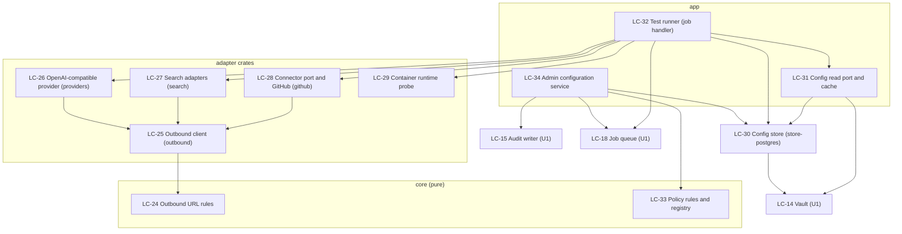

# U2 Instance Administration: Logical Components

New components, numbered on from U1 (LC-1 to LC-23). U1 components are reused unchanged unless a change is stated. Crates follow `unit-of-work.md` section 4 and the technology decisions T8 to T15.

## 1. Component map

Text alternative: the admin configuration service validates with the policy rules, writes through the config store (which seals secrets with the vault), records audit entries and enqueues test jobs. The test runner, running in the worker, reads configuration through the read port and calls the provider, search, GitHub and runtime adapters, all of which reach the network only through the outbound client, which applies the pure URL rules. Later units read configuration through the same read port.

## 2. Component catalogue

### LC-24 Outbound URL rules (core)
- **Responsibility**: parse and normalise an admin-entered URL into an `OutboundUrl`, or refuse it with a reason; classify hosts and addresses (loopback, private, link-local, metadata, IPv4-mapped, odd spellings); no I/O.
- **Interface**: `OutboundUrl::parse(text) -> Result<OutboundUrl, UrlRefusal>`, `classify(IpAddr) -> AddressClass`, `is_always_blocked(IpAddr) -> bool`.
- **Tests**: exhaustive tables (MT-10, SE-19).

### LC-25 Outbound client (`outbound` crate)
- **Responsibility**: the only HTTP path for admin-directed calls: own async resolver, all-address check, connect to a checked address, same-host redirects (max 3), timeouts (5 s connect, 15 s total), 1 MiB cap, TLS verification, no proxies, no cookies (pattern 1).
- **Interface**: `OutboundClient::send(OutboundUrl, Request) -> Result<Response, OutboundError>` where `OutboundError` is one of `Refused(reason)`, `Unreachable`, `Timeout`, `TooLarge`, `BadRedirect`.
- **Metrics**: `outbound_requests_total{target,outcome}`, `outbound_request_duration_seconds{target}`.
- **Enforcement**: clippy `disallowed-methods` elsewhere (SE-18).

### LC-26 OpenAI-compatible provider (`providers` crate)
- **Responsibility**: implement the `ModelProvider` port's probe operations for `kind = openai_compatible`: list models (`GET {base}/models`), chat probe, forced-`echo` tool probe, context-length extraction (T10). Maps outcomes to the fixed statuses; never relays remote text. Chat completion for runs arrives in U4 on the same adapter.
- **Interface**: `probe(connection, model_names, budget) -> ProviderProbeResult` (provider status plus per-model status and detected capabilities, streamed to a sink so each result can be stored as it lands).

### LC-27 Search adapters (`search` crate)
- **Responsibility**: the `SearchProvider` port for SearXNG, Brave Search and Tavily; U2 uses `test(connection)` (one small query, status only); `search(query)` arrives in U4.

### LC-28 Connector port and GitHub adapter (`github` crate)
- **Responsibility**: the `Connector` port (FR-12.1) and its GitHub implementation over plain REST (T7): `test(connection)` returns account login, token expiry from the response header and up to 100 reachable repositories with a total; fixed API base. Clone, push and pull-request calls arrive in U5.

### LC-29 Container runtime probe
- **Responsibility**: the `RuntimeProbe` port with a Docker implementation: one `GET /version` over the configured Unix socket (3 s, 64 KiB), result `reachable{name,version}`, `unreachable{reason}` or `not_configured` (pattern 6).

### LC-30 Config store (`store-postgres`)
- **Responsibility**: repositories for providers and models, model defaults, search configs and the active kind, the connector, sandbox policies (with `scope` and `version`) and test runs; seals and opens secrets through the vault with row-bound purposes; participates in the caller's transaction so a change and its audit entry commit together.
- **Data model additions** (refines T12): `providers`, `provider_models`, `model_defaults` (foreign keys to models, set null on delete), `search_configs`, `search_active`, `connectors`, `sandbox_policies` (key: scope), `config_test_runs` (target kind and id, status, requested by and at, started and finished at, per-probe results as structured data; partial unique index on target where status is `queued` or `running`).
- **Grants**: the app role may select, insert, update and delete these tables; none is an audit table (SE-26).

### LC-31 Config read port and cache (`app`)
- **Responsibility**: the server-side read model of W24: `list_models`, `defaults`, `resolve_model`, `active_search`, `github_credentials`, `effective_policy(scope)`; 5-second per-process snapshot cache; unseals secrets on demand into in-memory connection objects that cannot be logged (D6).

### LC-32 Test runner (`app`, executed by the worker)
- **Responsibility**: handle the `config_test` job: take the target's advisory lock, mark the run `running`, call the right adapter with its connection from LC-31, store each probe result as it lands, mark the run finished, audit `config.test.run`; honour the 60 s budget and concurrency of 4 (pattern 2). Also provides the recovery sweep for runs stuck `queued` over 120 s.
- **Metrics**: `config_test_total{target,status}`; U1's job metrics with `kind="config_test"`.

### LC-33 Policy rules and registry (`core`)
- **Responsibility**: the tool registry (A1), factory defaults and ranges (A2), validation of a candidate policy (BR-18), and the effective-policy clamp (BR-18.8); pure and table-tested.

### LC-34 Admin configuration service (`app`)
- **Responsibility**: use cases W16 to W23: provider create, update and remove with impact; defaults; search settings and activation; GitHub token; sandbox policy; start a test (insert run plus enqueue in one transaction, rate-limited); read a run. Every change writes its audit entry in the same transaction.

## 3. API surface added (provisional, finalised in Code Generation)
`/api/admin/providers` (list, create), `/api/admin/providers/{id}` (update, delete), `/api/admin/providers/{id}/impact`, `/api/admin/model-defaults`, `/api/admin/search`, `/api/admin/search/{kind}`, `/api/admin/search/active`, `/api/admin/connectors/github`, `/api/admin/sandbox-policy`, test starts `POST .../test` for providers, search kinds, GitHub and `POST /api/admin/sandbox-policy/check-runtime`, and `GET /api/admin/test-runs/{id}`. All are admin-only (`AdminUser`); test starts use the dedicated rate-limit bucket (SE-24).

## 4. Changes to existing components
| Component | Change |
|---|---|
| LC-2 Telemetry | Redaction rules gain the word `key` with an allow-list (pattern 3) |
| LC-18 Job queue | New job kind `config_test`; recovery sweep for stuck runs |
| LC-20 Cleanup job | Prunes test runs beyond the latest per target and the last 10 for 30 days (D3) |
| LC-1 Config loader | New optional `TANDEM_CONTAINER_SOCKET` |
| LC-7 Rate limiter | New bucket `Test`, 10 per minute per source |
| CLI `vault rekey` | Covers the new sealed columns (RL-10) |
| Audit catalogue | Eight new event types (A8) |
