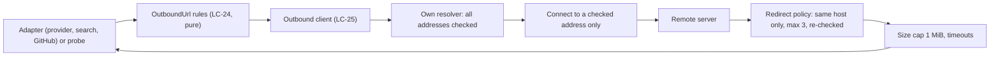
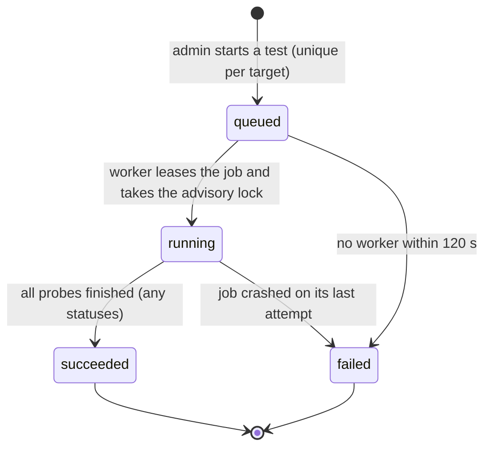

# U2 Instance Administration: NFR Design Patterns

Patterns and parameters that satisfy the U2 NFR requirements. They extend `u1-foundation/nfr-design/nfr-design-patterns.md`, which still applies in full. Component names (LC-n) refer to `logical-components.md` (LC-24 onwards are new; LC-1 to LC-23 are U1's). Requirement IDs are from `nfr-requirements.md`.

## 1. One outbound path (SE-18, SE-19, SE-25, RL-7)

Text alternative: an adapter hands a URL to the pure URL rules, which accept or refuse it; the outbound client then resolves the name with its own resolver, checks every address, connects only to a checked address, follows same-host redirects a few times with re-checks, and caps time and size before returning the response to the adapter.

| Step | Behaviour | Fails as |
|---|---|---|
| URL rules | Scheme, host class, no userinfo, query or fragment; trailing slash removed; `http` only for loopback, private-network and `.local`/`.internal` hosts (BR-19.1, BR-19.2) | `refused_address` at save and at call time |
| Resolution | The client's own async resolver returns every address; **all** are checked against the always-blocked ranges (169.254.0.0/16, fe80::/10, fd00:ec2::254, and IPv4-mapped forms of them); IPv4 spellings in decimal, octal or hex are parsed to addresses before checking (SE-19) | `refused_address` |
| Connect | The socket is opened to one of the checked addresses (no second lookup), so rebinding between check and connect is impossible | `unreachable` |
| Redirects | Never to a different host; same-host at most 3 times, each re-checked; `Authorization` and key headers are never sent to another host because no cross-host hop exists (SE-25) | `bad_response` |
| Limits | Connect 5 s, total 15 s, response read up to 1 MiB, TLS verification always on, no proxy environment variables honoured (D7), no cookies | `timeout`, `bad_response` |
| Enforcement | `reqwest::Client` construction is on the clippy `disallowed-methods` list for every application crate except `outbound`; CI fails otherwise (SE-18) | build failure |

Remote text never leaves this layer: adapters map outcomes to the fixed statuses and messages (SE-22).

## 2. Test runs as background jobs (RL-8, RL-9, PF-8, AV-6; Q1, Q3, D1 to D4)

- **Start**: `POST .../test` checks admin and the dedicated rate-limit bucket (SE-24), then inserts a run `queued` and enqueues a `config_test` job in **one transaction**. A partial unique index allows only one `queued` or `running` run per target; a violation answers `409 already running` with the active run's id so the screen can attach to it.
- **Run**: the worker takes `pg_try_advisory_lock` on a key derived from the target for the whole run, as a second guard against a re-leased job racing a zombie from a crashed worker (Q1). If the lock is taken, it re-queues the job with a short delay. It sets `running`, executes the probes through the outbound client, and **writes each probe result as it lands** (per model for providers), so the screen shows progress (D4).
- **Bounds**: 15 s per call, 60 s per run; provider models are probed with a concurrency of 4; models not finished in time are recorded `timeout` and the run still finishes as `succeeded` with partial results (N3, PF-8).
- **Finish**: results and the run's final status are stored together; the target's "last result" is the latest finished run (D3). Audit `config.test.run` is written after the run (RL-9: if the write fails the result still stands and the failure is logged).
- **Crash and retry**: a crash leaves the lease to lapse; the queue re-runs the job (3 attempts, U1 BR-13.3); the run restarts from `queued`, discarding partial results. After the last attempt the run is `failed` with a fixed message (D2). A run still `queued` after 120 s is marked `failed` by the recovery sweep ("No worker is available").
- **Screen**: polls `GET /api/admin/test-runs/{id}` once a second, for at most 90 s (D4); results are announced politely.
- **Outside failures never spread** (AV-6): a down provider only yields statuses; the admin screens and every other API keep working.

## 3. Secrets (SE-20, SE-21, BR-20, D6)

- Sealing: `provider_api_key`, `search_api_key`, `connector_secret` purposes, row id bound; written only by the write path; read only by the config read port (LC-31) and the test runner (which uses the port).
- Secret types: an in-memory `Secret` value with a redacting `Debug`/`Display`, no `Serialize`, zeroised on drop where practical; connection objects that carry one cannot be logged by accident (D6).
- Responses expose `saved` and `saved_at` only; update requests treat an absent or empty secret as "unchanged" and a distinct flag as "remove" (BR-20.3).
- **Log redaction fix (N5, SE-21)**: the U1 redaction layer's sensitive-name rules gain the word `key` (so `api_key`, `private_key`, `key`) with an allow-list for harmless names such as `key_id` and `key_saved_at`; a test asserts a provider save logs no key.
- Audit details record secrets as `set` or `not set` only (BR-21.2); test results never contain remote text (SE-22).

## 4. Configuration read model and cache (SC-6, PF-9, A12; Q2)

- One **read port** (LC-31) serves the runtime: models with capabilities and suitability, defaults, the active search connection, GitHub credentials, the effective sandbox policy.
- Each process keeps a small snapshot cache with a **5-second time limit**, rebuilt on the first read after expiry (one database read; no outbound call). The process that saves a change clears its own cache immediately; others converge within 5 s. No change notification is used (Q2).
- Security-sensitive state is not cached beyond this limit; a run captures its **effective policy** once at start and keeps it (BR-18.1), recording the policy `version` (D5).
- A snapshot contains sealed values only; unsealing happens on demand inside `resolve_*` calls, in memory, for the call (D6).

## 5. Sandbox policy resolution and validation (BR-18, A16)

- The policy service (LC-33) is pure: given a candidate policy and the container-probe result it returns the validated policy or the unmet rules (registry membership, `command_run` refusal, host-name syntax, ranges from the factory-defaults module, tier rule).
- **Factory defaults and ranges** live in one constants module with tests (MT-10); stored values always win; "Reset to default" is a client convenience that submits the factory value.
- **Effective policy** for a run: session scope if present, else instance; session values are clamped to the instance ceiling when read (BR-18.8). Only the instance scope is writable in U2, but the clamp function and tests exist now so the later session feature needs no redesign.
- Saving `container` requires a successful probe **in the same request** (a fresh probe, not a stored result) or is refused (BR-18.2).

## 6. Container runtime probe (SE-23, N6, T11)

Opt-in through `TANDEM_CONTAINER_SOCKET` (absent: the probe reports `not_configured`, the tier is unavailable). One hand-written HTTP/1.1 `GET /version` over the Unix socket, 3 s timeout, 64 KiB cap, no other call, no container created, listed or stopped; reply parsed for runtime name and version only. It runs as a test-run job like the others (D1).

## 7. Audit and transactions (BR-21, RL-11, SE-26)

- A change and its audit entry share one transaction (U1 pattern); removing a provider also clears defaults and writes `config.provider.deleted` with what was cleared, all in the same transaction (RL-11).
- Tests record `config.test.run` after the run (RL-9). Entries carry before and after values with secrets reduced to `set` or `not set`.
- `tandem vault rekey` gains the new sealed columns in the same transaction as U1's values (RL-10).

## 8. Observability (OB-5, OB-6)

- `outbound_requests_total{target,outcome}`, `outbound_request_duration_seconds{target}`, `config_test_total{target,status}`; `target` is the kind, never a host.
- Test logs carry target kind, status, duration and host name only. Job metrics from U1 (`job_duration_seconds{kind="config_test"}`) cover the runner.

## 9. Testability (MT-9, MT-10)

- Pure rule modules (outbound URL, policy validation and clamping, capability suitability) have table-driven tests.
- Adapters are tested against in-process loopback mock servers (axum) that imitate an OpenAI-compatible server (with and without tool support or a model listing), SearXNG, Brave, Tavily, GitHub and the Docker socket (a Unix listener), including slow, oversized, malformed and redirecting answers and a rebinding resolver.
- The run state machine is tested with the in-memory fakes and, for the advisory lock, the Postgres harness (two workers, one run).

## 10. Traceability: requirement to pattern and component

| Requirement | Pattern | Component |
|---|---|---|
| SC-5, SC-6, PF-9 | 4 | LC-31 |
| PF-7 | 4, 7 | LC-30, LC-34 |
| PF-8, RL-8 | 2 | LC-32 |
| AV-6, AV-7 | 2, 4 | LC-31, LC-32 |
| RL-7 | 1 | LC-25 |
| RL-9, RL-11, SE-26 | 7 | LC-30, LC-34 |
| RL-10 | 7 | LC-30 (with the CLI) |
| SE-18, SE-19, SE-25 | 1 | LC-24, LC-25 |
| SE-20, SE-21 | 3 | LC-30, LC-31, LC-2 |
| SE-22 | 1, 2 | LC-26 to LC-29, LC-32 |
| SE-23 | 6 | LC-29 |
| SE-24 | 2 | LC-7, LC-9 |
| OB-5, OB-6 | 8 | LC-3, LC-25 |
| MT-9, MT-10 | 9 | all adapters, LC-24, LC-33 |
