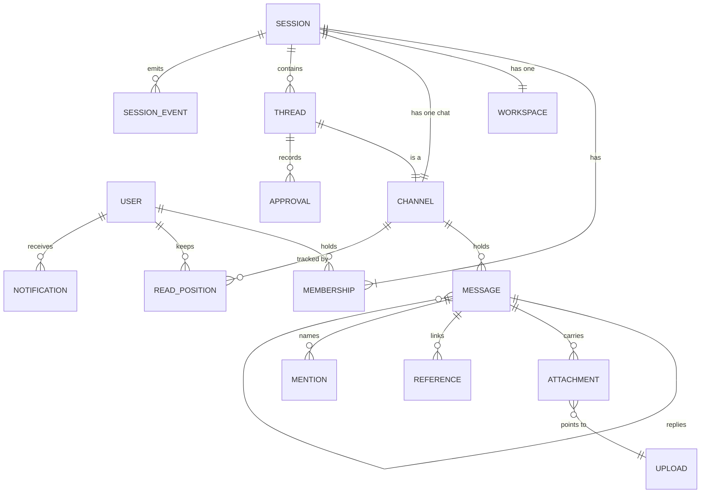

# U3 Collaboration Core: Domain Entities

Technology-agnostic. Every entity below belongs to one **session**, except notifications and the reminder setting
at instance level. These entities **replace** the U1 walking-skeleton `ChatSession` and `ChatMessage` (U1
domain-entities §4); the skeleton tables are migrated or dropped in Code Generation.

Decisions referenced: Q1 to Q15 in `construction/plans/u3-collaboration-core-functional-design-plan.md`, and C1 to
C6 in `u3-collaboration-core-functional-design-clarification-questions.md`.

## 1. Overview

Text alternative:
- **Session:** a session has several memberships, one per user who belongs, and exactly one workspace (a managed
  folder in U3).
- **Channels:** messages live in a channel. Each session has one chat channel, and each thread is also a channel.
  A message can have replies (one level deep) and carry attachments, each pointing at an upload. It can also hold
  references to other items and mentions of users.
- **Approvals:** a thread keeps a list of approval records.
- **Per user:** each user keeps one read position per channel and receives notifications.
- **Events:** the session emits an ordered stream of events for real-time delivery.

## 2. Sessions and membership

### Session
| Field | Meaning and rules |
|---|---|
| `id` | Opaque identifier. Never guessable: knowing an id grants nothing (BR-23) |
| `title` | 1 to 120 characters, trimmed. Not unique |
| `prompt` | The initial prompt, Markdown, 1 to 20,000 characters (BR-26). Editable by the owner while the session is active; edits are recorded as a system message |
| `owner_id` | Exactly one owner, always a member (BR-22.4) |
| `visibility` | `open` (default) or `private` (C1 B). Set at creation; changed later only by the owner or an admin (BR-23.4) |
| `state` | `active`, `ended` or `archived` (BR-30) |
| `workspace_kind` | `managed_folder` in U3; `repository` arrives in U5 |
| `reminder_period` | Optional per-session override for quiet-thread reminders: a period, or `off`. Empty means "use the instance value" (BR-31) |
| `created_at`, `ended_at`, `archived_at` | Times of the lifecycle changes; `ended_by`, `archived_by` record who |
| `follow_up_of` | Optional link to the ended session this one follows. The field is reserved for U4 (US-11.8) |
| `closing_summary` | Reserved for U4 (US-11.7). Empty in U3 (C6 B) |
| `next_sequence` | Per-session counter. Every message and event takes the next number (BR-29) |

### Membership
| Field | Meaning and rules |
|---|---|
| `session_id`, `user_id` | Unique pair |
| `role` | `owner` or `member`. Exactly one `owner` per session |
| `added_by`, `added_at` | Who added them and when. An admin adding themselves is recorded as such (C3 B) |
| `removed_at`, `removed_by` | Set on removal, so the record stays and past messages and approvals remain attributed (US-3.4). A removed user can be added again, which clears these fields |

A deactivated user keeps their membership but cannot sign in (A1). Their messages and approvals stay attributed to
them.

### Workspace (managed folder)
| Field | Meaning and rules |
|---|---|
| `session_id` | One workspace per session |
| `kind` | `managed_folder` |
| `status` | `ready`, `removing`, `removed`, `removal_failed` |

In U3 the folder starts empty, and nothing writes to it until U5 and U6 add tools. Ending the session removes it;
a failed removal is retried, never ignored (US-11.5 pattern, BR-30.4).

## 3. Channels, threads and messages

### Channel
A place that holds messages. Each session has exactly one `chat` channel, created with the session, and each thread
is one `thread` channel.

| Field | Meaning and rules |
|---|---|
| `id`, `session_id` | |
| `kind` | `chat` or `thread` |
| `last_message_sequence` | The sequence number of the newest message, used for unread indicators (BR-32) |

### Thread
| Field | Meaning and rules |
|---|---|
| `channel_id` | The thread's channel |
| `title` | 1 to 200 characters |
| `origin` | `member` in U3 (Q4 A). `orchestrator` is reserved for U4's question threads |
| `opened_by`, `opened_at` | |
| `status` | `open`, `approved` or `reopened` (BR-27) |
| `current_approval_id` | The approval in force, if the thread is `approved` |
| `last_activity_at` | Time of the newest message or status change, which drives quiet-thread reminders (BR-31) |
| `reminded_at` | When the last reminder for the current quiet period was sent |
| `round_id`, `plan_step_id` | Reserved for U4 and U6 |

### Message
| Field | Meaning and rules |
|---|---|
| `id`, `channel_id` | |
| `sequence` | From the session counter. It gives the order within the session (BR-29) |
| `author_kind` | `person`, `agent` or `system` (A10). U3 writes `person` and `system` |
| `author_id` | The user, for `person` |
| `parent_id` | Set on replies. The parent is always a top-level message in the same channel (Q8 A, BR-25.3) |
| `body` | Markdown, 1 to 20,000 characters after trimming (Q9 A). Empty is allowed only when the message has attachments |
| `system_kind` | For system messages: `thread_approved`, `approval_revoked`, `member_added`, `member_removed`, `owner_changed`, `visibility_changed`, `prompt_edited`, `session_ended` |
| `reply_count`, `last_reply_at` | Kept on top-level messages |
| `edited_at` | Set when the author edits (Q7 A). Only the current text is shown |
| `deleted_at` | Set when the author deletes. The body and attachments are removed, and a placeholder remains (BR-25.5) |
| `created_at` | Server time |

### Attachment and Upload
An **upload** is the stored file; an **attachment** places it on a message. A file is uploaded first and then sent
with a message, and an upload that is never attached is discarded (BR-26.4).

| Upload field | Meaning and rules |
|---|---|
| `id`, `session_id` | Uploads never cross sessions (BR-23.6) |
| `uploaded_by`, `uploaded_at` | |
| `file_name` | As given, cleaned for display and download (path separators and control characters removed), up to 255 bytes |
| `size` | Up to 25 MiB (Q9 A) |
| `sha256` | Content hash (US-5.5, A12) |
| `declared_type`, `sniffed_type` | What the browser said and what the content looks like. The sniffed type decides how the file is served (BR-28.4) |
| `state` | `pending` (uploaded, not yet sent), `attached`, `discarded` or `expired` (deleted after the retention period, BR-26.7) |

### Reference
A link from a message to another item, stored when the message is saved and resolved each time it is shown (A13).

| Field | Meaning and rules |
|---|---|
| `message_id` | |
| `target_kind` | `thread`, `message` or `upload` in U3. `artifact` and `workspace_file` are reserved for U5 and U6 |
| `target_id` | Must belong to the same session when written (BR-25.6) |

### Mention
| Field | Meaning and rules |
|---|---|
| `message_id`, `user_id` | A person named with `@` (C4 C). Agent mentions (`@ask` and the rest) arrive in U4 as a separate kind |

## 4. Approvals

### Approval
| Field | Meaning and rules |
|---|---|
| `id`, `thread_id` | A thread keeps every approval it has had, so post-MVP rules needing several approvals fit without reshaping (A3) |
| `approved_by`, `approved_at` | Always a person who is a member (BR-27.2) |
| `summary` | The outcome summary: required, 1 to 5,000 characters, Markdown (Q5 B, BR-27.3) |
| `summary_source` | `person` in U3. `orchestrator_draft_edited` is reserved for U4 |
| `revoked_by`, `revoked_at`, `revoke_reason` | Set on revoke. The reason is optional, up to 500 characters |

The approval in force is the thread's `current_approval_id`. A revoked approval stays in the history.

## 5. Reading, presence and notifications

### ReadPosition
| Field | Meaning and rules |
|---|---|
| `user_id`, `channel_id` | Unique pair. Members only (C2 A) |
| `last_read_sequence` | Moves forward only (BR-32.2) |

### Presence (not stored)
Presence is held in memory by the real-time gateway, per session and per user: `online` while one of the user's
tabs has the session open and is active, and `away` when idle for 5 minutes. A user with no open tab is not shown
as present (Q13 A). Only members appear (C2 A).

### Notification
| Field | Meaning and rules |
|---|---|
| `id`, `user_id` | The recipient |
| `kind` | `mention`, `thread_quiet` in U3. `plan_ready` and `task_output_ready` are reserved for U6 |
| `session_id`, `target_kind`, `target_id` | What it opens (US-12.1, US-12.2) |
| `actor_id` | Who caused it, if anyone |
| `created_at`, `read_at` | |

A notification holds no message text, only a reference. Its title is built when it is shown, so a user who has lost
access sees "unavailable" (BR-33.5).

### Reminder settings
| Level | Where it is kept | Values |
|---|---|---|
| Built-in | Code | One business day (BR-31.2) |
| Instance | Instance settings (U1 entity), new field `thread_reminder_period` and new field `time_zone` | A period, `off`, or empty for the built-in default. The time zone defaults to UTC |
| Session | `Session.reminder_period` | A period, `off`, or empty for the instance value |

## 6. Session events
The ordered stream the real-time gateway delivers (A9). Each event carries the session id, its sequence number,
a kind and the ids it concerns: `message.created`, `message.edited`, `message.deleted`, `thread.created`,
`thread.status_changed`, `member.added`, `member.removed`, `session.updated`, `session.ended`, `session.archived`,
`session.unarchived`, `read.updated` (to the same user only) and `presence.changed`. Events carry ids and safe
summaries only. Clients fetch content through the normal, authorised reads (BR-29.3).

## 7. Audit events added (A11, C3 B)
- **Sessions:** `session.created`, `session.visibility_changed`, `session.owner_changed`, `session.ended`,
  `session.archived`, `session.unarchived`, `session.reminder_changed`.
- **Members:** `session.member_added`, `session.member_removed`.
- **Admin and settings:** `session.admin_joined`, and `settings.updated` for the instance reminder period and time
  zone.
- **Threads and uploads:** `thread.created`, `thread.approved`, `thread.approval_revoked`, `upload.stored`.

Each entry records the actor, and whether they acted as an admin who is not the owner. Message text and file
contents are never audited.
