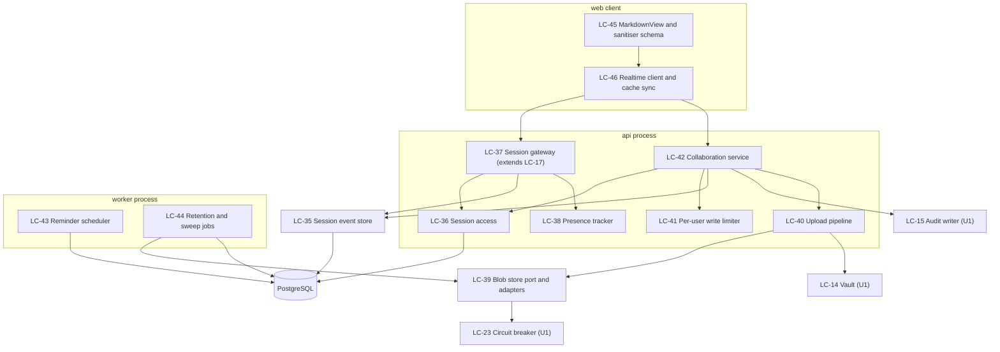

# U3 Collaboration Core: Logical Components

New components LC-35 to LC-46, and changes to U1 and U2 components. Crate placement is provisional until Code
Generation.

## 1. Component map

Text alternative:
- **Writes.** The web client sends writes to the collaboration service. The service checks access, applies the
  per-user limits, writes the change and its session event in one transaction, records audit entries, and passes
  uploads to the upload pipeline. The pipeline encrypts with the vault and stores through the blob store port,
  behind the circuit breaker.
- **Delivery.** The session gateway in each `api` process reads new events from the event store when notified,
  re-checks access, and sends thin events to subscribed browsers. It works with the presence tracker.
- **In the browser.** The realtime client batches fetches and updates its caches, and `MarkdownView` renders content
  through the shared sanitiser schema.
- **Worker.** The worker runs the reminder scheduler and the retention and sweep jobs.

## 2. Component catalogue

### LC-35 Session event store (`store-postgres`)
- **Holds.** The `session_events` table: session id, sequence, kind, ids, safe metadata and commit time. The
  primary key is (session, sequence).
- **Writes.** `append(tx, session, kind, data)` allocates the sequence (§2 of the patterns) and queues the `NOTIFY`
  for after commit.
- **Reads.** `read_after(session, sequence, limit)` and `oldest_retained(session)`.
- **Pruning.** By the window in N5.

### LC-36 Session access (`app`)
- **The one decision.** `access(user, session, need)` returns the result of the logic model's §1.
- **Extractors.** Axum extractors build on it: `SessionRead`, `SessionWrite` and `SessionManage`.
- **Child lookups.** `scoped` helpers look up child ids within the session.
- **Pure core.** The decision table is a pure function in `core`, so it can be tested exhaustively (MT-13).

### LC-37 Session gateway (`api`, extends LC-17)
- **Subscriptions.** Subscriptions per session and a per-user channel.
- **Delivery.** `NOTIFY` listening with catch-up, an access cache with event-driven clearing, a bounded send queue
  per connection, and the frame and connection limits.
- **Listener resilience.** Reconnect, gap replay, and polling while disconnected (Q1 A).

### LC-38 Presence tracker (`api`)
- **State.** Local connection state, plus a merged view from peer announcements on `tandem_presence`.
- **Lifecycle.** Repeats announcements every 60 s, and drops a silent peer after 150 s.
- **Output.** `presence.changed` events to members only.

### LC-39 Blob store port and adapters (`blobstore` crate)
- **Port.** `put_temp`, `promote`, `get`, `delete`, `head` and `health`, all streaming.
- **Adapters.** `LocalBlobStore` (a directory under `TANDEM_DATA_DIR`, with atomic rename) and `S3BlobStore` (over
  the outbound client, following BR-19).
- **Resilience.** Wrapped by the U1 circuit breaker, with timeouts and retries for idempotent calls (pattern §7).
  Both adapters pass one contract suite (MT-17).

### LC-40 Upload pipeline (`app`)
- **Stages.** Size guard, hasher, sniffer, chunked AES-256-GCM, then a temporary put.
- **Writes.** Row insert and commit, then promote.
- **Downloads.** The reverse path, with tag verification and the SE-30 headers.
- **Keys and quota.** Data keys are sealed with the vault under the `upload` purpose. The quota is checked under the
  session lock.

### LC-41 Per-user write limiter (`api`, extends LC-7)
- **Buckets.** `message` (30 per 10 s), `upload` (20 per minute), `thread` (10 per minute) and `membership` (30 per
  minute), keyed by user id.
- **Refusals.** A 429 with `Retry-After`.

### LC-42 Collaboration service (`app`)
- **Use cases.** Sessions, membership, threads, messages, references, mentions, approvals, lifecycle, read positions
  and notifications, as in the logic model.
- **Transactions.** Each use case runs one transaction, with the guards in pattern §11.
- **Hooks.** It owns the hook interfaces for later units: `DependencyCheck`, `WorkspaceChangeCheck` and
  `AgreedContext`.

### LC-43 Reminder scheduler (`worker`)
- **Loop.** A 5-minute loop over threads due by `remind_at`, using `SKIP LOCKED`.
- **Calculation.** The business-day function lives in `core`.
- **Recomputing.** `remind_at` is recomputed when a period setting changes, as a batch job.

### LC-44 Retention and sweep jobs (`worker`)
- **Jobs.** `discard_pending_uploads`, `prune_session_events`, `prune_notifications`, `expire_uploads`,
  `sweep_blob_orphans` and `remove_workspace`.
- **Batching.** Batches of 500, with a time budget and self-rescheduling.

### LC-45 MarkdownView and sanitiser schema (`web`)
- **Rendering.** `react-markdown`, `remark-gfm` and `rehype-sanitize` with `markdown/schema.ts`.
- **Highlighting.** `highlight.js` tokens rendered as spans.
- **Images.** The upload-image rewrite.
- **Guards.** ESLint guards, and Trusted Types enforced by the CSP.

### LC-46 Realtime client and cache sync (`web`)
- **Connection.** One socket per tab, reconnect with backoff, and resume by sequence.
- **Events.** The 50 ms batch window for fetches. Events are applied to TanStack Query caches, with duplicates
  ignored by sequence.
- **Presence.** Presence pings on input, throttled to 1 per 30 s.

## 3. API surface added (provisional, finalised in Code Generation)
- **Sessions.** `GET, POST /api/sessions`, plus `GET, PATCH /api/sessions/{id}` and
  `GET /api/sessions/{id}/overview`. Lifecycle actions are `POST …/end`, `…/archive` and `…/unarchive`.
- **Members and owner.** `GET, POST, DELETE …/members` and `POST …/owner`.
- **Threads and channels.** `GET, POST …/threads` and `PATCH …/threads/{tid}`. Messages are
  `GET …/channels/{cid}/messages?before|after=`, with `POST` to the same path, and `PATCH, DELETE …/messages/{mid}`.
- **Approvals.** `POST …/threads/{tid}/approvals` and `POST …/threads/{tid}/approvals/current/revoke`.
- **Uploads.** `POST …/uploads` and `GET …/uploads/{uid}`.
- **Read positions and search.** `POST …/read`, and `GET …/search?q=` for titles.
- **Notifications.** `GET /api/notifications` and `POST /api/notifications/read`.
- **Admin.** `GET /api/admin/sessions`.
- **WebSocket.** The U1 endpoint, with the new frame kinds.

## 4. Changes to existing components
| Component | Change |
|---|---|
| LC-4 Health checker | Adds the blob store check, reported as `degraded` without failing readiness (Q5 A; AV-8 revised) |
| LC-14 Vault | Adds the `upload` purpose. The U2 `rekey` command rewraps upload data keys |
| LC-16 Outbox | Session-scoped events move to LC-35. The outbox keeps jobs and the per-user channel (notifications) |
| LC-17 Event hub | Becomes LC-37 (sessions, catch-up, access cache). The skeleton chat events are removed |
| LC-6 Request pipeline | Adds the per-user limiter (LC-41) after authentication, and the upload body limit on the upload route |
| LC-22 Web asset server | Adds `require-trusted-types-for 'script'` to the CSP |
| Instance settings (U1) | Add the reminder period, time zone and upload retention |
| U1 skeleton chat tables | Replaced by the U3 schema. The skeleton session and messages are migrated to a session with a chat channel |
