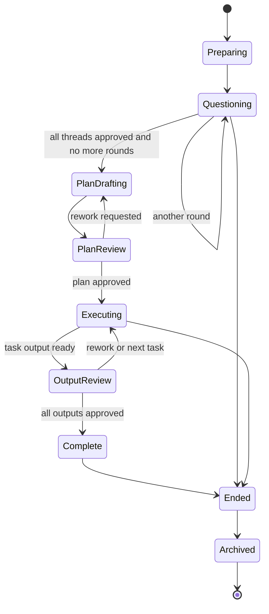
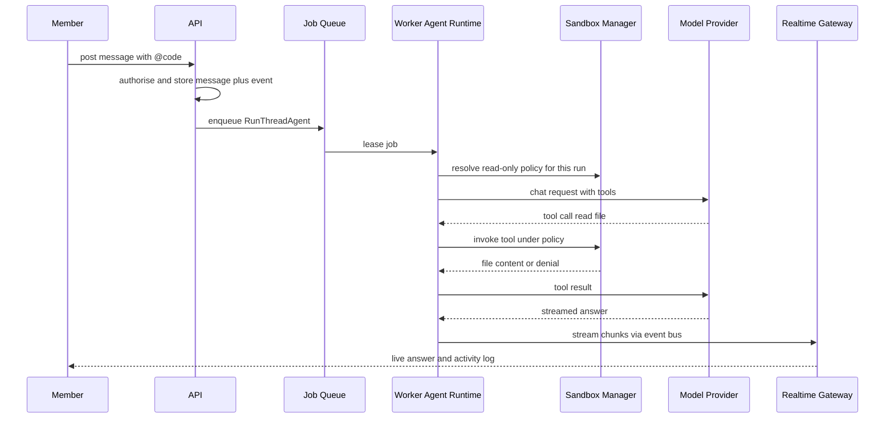
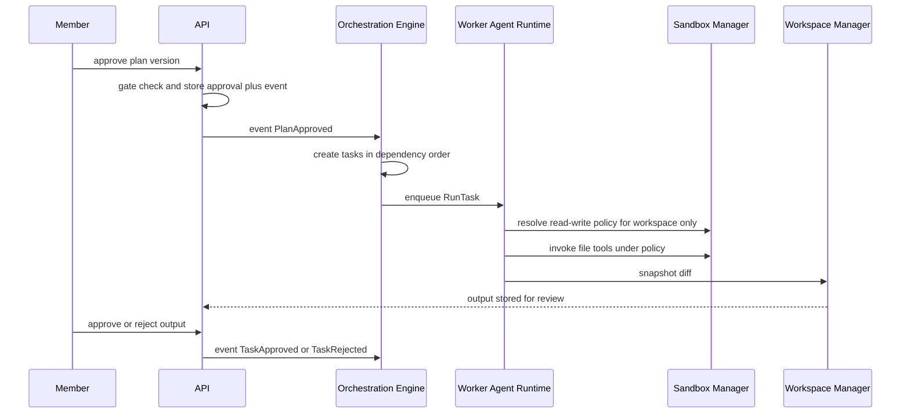
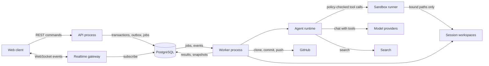
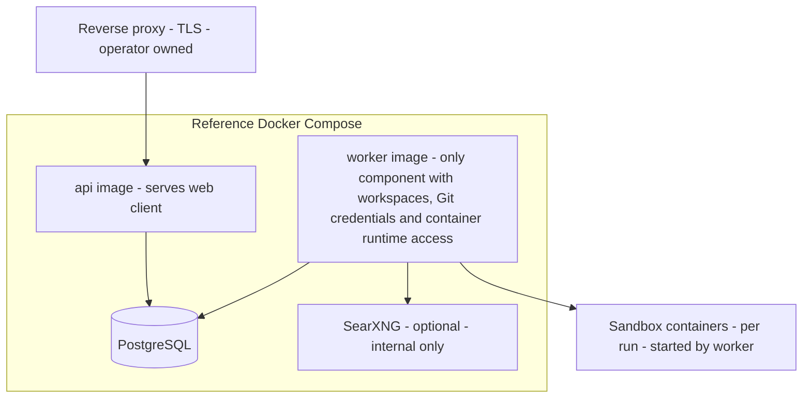

# Tandem: Application Design (consolidated)

This document consolidates `components.md`, `component-methods.md`, `services.md` and `component-dependency.md`. It adds the decisions, requirement changes, traceability and compliance checks that span them.

## Part 0. Overview

### Architecture in one paragraph
Tandem is a hexagonal system in one Rust workspace. A pure `core` holds the domain model and state machines; services in `app` implement the use cases over ports; adapters implement the ports. Two binaries, `api` and `worker`, are built into two images. The API handles commands and serves the React client; the worker runs everything that calls a model, Git or a sandbox. Coordination uses a transactional outbox, a PostgreSQL job queue and `LISTEN/NOTIFY`. Code owns a durable state machine for the session lifecycle; the orchestrator model only proposes content, which code validates. Agent tool calls pass through a policy-enforced tool layer and a configurable runner (in-process or per-run container) so limits hold even if a model ignores its instructions.

### Decisions
| # | Decision | Source |
|---|---|---|
| D1 | Separate `api` and `worker` services; one repo with shared crates | Q1 and follow-up |
| D2 | PostgreSQL job queue using `SKIP LOCKED` | Q2 |
| D3 | In-process event hub behind an interface; `LISTEN/NOTIFY` across processes | Q3 |
| D4 | Policy-enforced sandbox with tiered runners; agent loop and credentials stay in the worker | Q4 and follow-ups |
| D5 | Code-owned durable state machine; model proposes, code validates | Q5 |
| D6 | libgit2 (`git2`) for Git; credentials are short-lived and never written to disk | Q6 |
| D7 | Vite + React SPA (PWA) served by the `api` image | Q7 |
| D8 | Hexagonal structure with ports for provider, search, connector, blob, Git, runner, queue, events and vault | Q8 |
| D9 | REST plus one WebSocket per client; generated OpenAPI types | X1 |

### Requirement changes this design implies (for your approval)
The approved requirements and stories are not edited silently. If you approve this design, I will apply these changes to `requirements.md` and `stories.md` in the next commit.

| # | Change | Reason |
|---|---|---|
| RD1 | **Add FR-16 Sandbox policy**: an admin-configured, instance-wide policy (default runner tier, tool allow-list, network rule, resource limits); per-run path bindings derived from session grants; enforced outside the model | Your Q4 answer |
| RD2 | **Add story US-2.9** "Configure the sandbox policy" (ADM, FR-16, Must) and extend US-9.3 and US-6.8 to reference the policy | Same |
| RD3 | **NFR-2.1**: reference Compose file now runs `api`, `worker`, PostgreSQL, optional SearXNG | Q1 |
| RD4 | **NFR-1.2**: Git access uses libgit2 (a native dependency in the build and image) | Q6 |
| RD5 | **Self-hosting guide** documents the container runner's host requirement (container runtime reachable only from the worker; rootless recommended) | X7 |
| RD6 | **FR-8.3 unchanged**: still no command execution in the MVP; the tool layer defines a command tool that policy disables | X8 |

### Items to confirm at approval
1. **X5**: one instance-wide policy with paths bound per run (not per-session choice). Per-session overrides are post-MVP.
2. **X7**: the container runner is in the MVP design. This enlarges the MVP; the alternative is to build the in-process runner first and the container runner immediately after.
3. **D1**: the API and worker are separate images from day one, which means the worker is the only deployable with workspace, Git and container-runtime access.

### Traceability: epics to components
| Epic | Components |
|---|---|
| E1 Accounts and access | C2, C4, C13, C24, C27 |
| E2 Instance administration | C12, C13, C20, C21, C22, C24 |
| E3 Sessions and workspaces | C4, C5, C17, C22 |
| E4 Orchestrator question rounds | C6, C14, C15 |
| E5 Threads and messaging | C3, C6, C19, C23 |
| E6 Thread agents | C7, C15, C16, C17, C20, C21 |
| E7 Approvals | C7, C13 |
| E8 Plan | C7, C8, C14 |
| E9 Tasks and output review | C9, C14, C15, C16, C17 |
| E10 Artifacts | C10, C23 |
| E11 Commit and end of session | C5, C17, C22 |
| E12 Notifications and presence | C3, C11 |
| E13 Security, resilience and usability | C1, C2, C12, C26, C27 |

Every epic maps to at least one component, and every component is used by at least one epic or by a cross-cutting requirement (C18, C19, C25 support all of the above).

### Extension compliance (this stage)
| Rule | Status | How the design meets it |
|---|---|---|
| SECURITY-05 Input validation | Compliant (design) | C2 validates every request and message with size limits; WebSocket messages validated the same way |
| SECURITY-06 Least privilege | Compliant (design) | Separate images; the API has no Git credentials, workspace or runtime access; non-root containers |
| SECURITY-07 Network exposure | Compliant (design) | Only the proxy entry point is exposed; PostgreSQL, SearXNG and sandboxes are internal |
| SECURITY-08 Authorisation | Compliant (design) | Central `authorize` in C4; no unauthenticated path except sign-in and first-run setup |
| SECURITY-11 Secure design | Compliant (design) | Agents untrusted; policy-enforced tool layer; code owns gates; credentials never enter sandboxes |
| SECURITY-15 Fail-safe | Compliant (design) | Sandbox, orchestrator and provider failures leave state unchanged and fail closed |
| Other SECURITY rules | N/A at this stage | Implementation-level; handled in NFR Requirements, NFR Design and Infrastructure Design |
| RESILIENCY-01 Criticality | Compliant | Class and business impact documented per component in `components.md` section 2; dependencies in `component-dependency.md` |
| RESILIENCY-06 Health checks | Compliant (design) | `/healthz` and `/readyz` in C26 |
| RESILIENCY-10 Circuit breaking | Compliant (design) | In the provider, search and connector adapters |
| Other RESILIENCY rules | N/A at this stage | Operator-owned or handled in later stages (NFR-5.4) |
| Property-Based Testing | Disabled | Skipped per Requirements Analysis |

---

# Part 1. Components

**Basis**: `requirements.md`, `stories.md`, `application-design-plan.md` (decisions Q1 to Q8, assumptions X1 to X8).
**Style**: Hexagonal. A domain core with no I/O; ports for everything external; adapters and delivery mechanisms around it.
**Deployables**: `api` image (also serves the web client), `worker` image, PostgreSQL, optional SearXNG, and short-lived sandbox containers started by the worker.

## 1. Deployables and code layout

One repository, one Rust workspace, shared crates, two binaries.

| Unit | Kind | Contains |
|---|---|---|
| `web` | Vite + React SPA (PWA) | C1 |
| `api` binary | Deployable (stateless) | C2, C3, plus application services in request mode |
| `worker` binary | Deployable (scalable) | C14 to C17, C18 consumer, application services in job mode |
| `core` crate | Library | Domain model and state machines (C5 to C10 rules); no I/O |
| `app` crate | Library | Application services and use cases (C4 to C13) over ports |
| `ports` crate | Library | Port traits (provider, search, connector, blob, git, runner, queue, event bus, vault) |
| adapter crates | Libraries | Postgres, providers, search, GitHub, git, blob, vault, runners |

## 2. Component catalogue

Criticality classes (RESILIENCY-01): **Critical** = loss stops use or risks data or security; **High** = core loop degrades; **Medium** = a feature degrades with a clear fallback. Business impact is stated for the self-hosting team (there is no revenue or regulatory dependency; impact is blocked work or lost decisions).

### Client and delivery

| ID | Component | Responsibilities | Interfaces | Class | Impact if unavailable |
|---|---|---|---|---|---|
| C1 | **Web Client** | Sessions, threads, chat, plan and task review, artifacts, admin screens; responsive, light/dark, PWA; renders sanitised Markdown and Mermaid | Calls C2 (REST), connects to C3 (WebSocket) | High | Users cannot interact; server state is unaffected |
| C2 | **HTTP API** | REST endpoints, authentication middleware, input validation, rate limiting, security headers, OpenAPI description; serves the static client | REST over TLS (behind a reverse proxy); calls application services | Critical | Nothing can be read or changed |
| C3 | **Realtime Gateway** | One WebSocket per client; authorises subscriptions to sessions; delivers events, presence and agent streaming | WebSocket; subscribes to C19 | High | Live updates stop; REST still works and clients can refresh |

### Application services (shared `app` crate)

| ID | Component | Responsibilities | Class | Impact if unavailable |
|---|---|---|---|---|
| C4 | **Identity and Access** | Users, invitations, sign-in, Argon2id, breached-password check, TOTP MFA, cookies and server-side sessions, lockout, roles; central `authorize(...)` for membership and admin checks | Critical | No sign-in or authorisation; system fails closed |
| C5 | **Session Service** | Sessions, membership, workspace choice, per-session model choice, session lifecycle state machine (`active`, `ended`, `archived`) | High | Cannot start, end or change sessions |
| C6 | **Thread and Messaging** | Question rounds as threads, messages, replies, references, uploads (metadata), session chat, thread status | High | Discussion stops |
| C7 | **Approval Service** | Single-approval rule for threads, plan and task output (data model supports richer rules later), revoke, dependency check before revoke, outcome summary confirmation | Critical | Gates cannot open; nothing proceeds (safe failure) |
| C8 | **Plan Service** | Plan versions, steps, dependencies, step-to-thread traceability, rework requests, plan approval gate | High | Planning blocked |
| C9 | **Task Service** | Task records and status, dependency ordering, output snapshots (diff or artifact version), accept, reject with feedback, discard, retry | High | Work cannot be tracked or reviewed |
| C10 | **Artifact Service** | Versioned artifacts, diff between versions, edit, download, save into workspace | Medium | Artifacts unavailable; discussion and approvals still work |
| C11 | **Notification and Presence** | In-app notifications, unread counters, presence | Medium | Fewer prompts to act; nothing is lost |
| C12 | **Admin and Settings** | Model providers, defaults, search providers, connectors, **sandbox policy** (new), instance settings, token usage view | High | Cannot reconfigure; running sessions continue |
| C13 | **Audit Service** | Append-only security audit log (SECURITY-14) with filters | High | Security events not recorded (writers fail loudly rather than skip) |

### Worker-side components

| ID | Component | Responsibilities | Class | Impact if unavailable |
|---|---|---|---|---|
| C14 | **Orchestration Engine** | Consumes domain events; drives the durable lifecycle state machine; enqueues jobs for question rounds, outcome summaries, plan drafting and task execution; validates every orchestrator proposal before applying it | Critical | Sessions stall at the next transition; state is safe in the database |
| C15 | **Agent Runtime** | Builds context, runs the provider-agnostic agent loop for orchestrator, thread agents and task agents, streams output, records the activity log; holds model credentials; routes tool calls through the policy-checked tool layer | High | `@` agents and tasks stop; discussion and approvals continue |
| C16 | **Sandbox Manager** | Resolves the instance-wide sandbox policy into a per-run policy; selects the runner; enforces path, tool, network and resource rules; runners: **in-process** (tool-layer confinement) and **container** (per-run, mounted paths only, network off by default) | Critical | No tool can run; agents fail closed |
| C17 | **Workspace Manager** | Clones into isolated worktrees via libgit2, session branches, read-only extra repos, snapshots diffs, commit and push, cleanup on session end; only component with Git credentials and workspace access | Critical | Repo sessions cannot start, commit or clean up |

### Infrastructure services

| ID | Component | Responsibilities | Class | Impact if unavailable |
|---|---|---|---|---|
| C18 | **Job Queue** | PostgreSQL queue (`SKIP LOCKED`): enqueue, lease, heartbeat, retry with backoff, dead-letter, resume after restart | High | Background work pauses; resumes on recovery |
| C19 | **Event Bus** | In-process hub behind a port; `LISTEN/NOTIFY` between API and worker processes; fan-out to C3 | High | Live updates and cross-process triggers delayed; polling fallback via the queue |
| C20 | **Model Provider Port and adapters** | OpenAI-compatible, Anthropic API, optional Agent SDK; capability discovery; timeouts, retries, circuit breaking | High | Agents degrade with a clear message (NFR-5.2) |
| C21 | **Search Port and adapters** | SearXNG default, Brave, Tavily | Medium | `@search` shows an unavailable message |
| C22 | **Connector Port and GitHub adapter** | Repo listing, clone credentials, push, pull request creation; credentials encrypted | High | Repo sessions cannot clone or push; managed-folder sessions unaffected |
| C23 | **Blob Store Port and adapters** | Local-disk adapter; content hashes; S3-compatible later | High | Uploads and artifact bodies unavailable |
| C24 | **Secret Vault** | Application-level envelope encryption for provider keys, connector tokens and TOTP secrets; key from env or file | Critical | Secrets unreadable; dependent features fail closed |
| C25 | **Persistence** | PostgreSQL repositories, reversible versioned migrations, transactions | Critical | System down |
| C26 | **Observability** | Structured logs with request IDs, Prometheus metrics, `/healthz` and `/readyz` | High | Operators lose visibility; behaviour unaffected |
| C27 | **Operations CLI** | First-run bootstrap, migrations, backup and restore, admin recovery | High | Operators lose maintenance tooling; runtime unaffected |

## 3. Key interface contracts (summary)

| Port | Purpose | Implementations in MVP |
|---|---|---|
| `ModelProvider` | Chat completion with tools, streaming, capability probe | OpenAI-compatible, Anthropic, Agent SDK |
| `SearchProvider` | Web search with cited results | SearXNG, Brave, Tavily |
| `Connector` | Repo list, clone auth, push, create PR | GitHub |
| `BlobStore` | Put, get and delete content by hash | Local disk |
| `GitWorkspace` | Clone, worktree, diff, commit, push, delete | libgit2 adapter |
| `SandboxRunner` | Execute a policy-bound tool call | In-process, container |
| `JobQueue` | Enqueue, lease, complete, fail | PostgreSQL |
| `EventBus` | Publish and subscribe to domain and UI events | In-process plus `LISTEN/NOTIFY` |
| `SecretVault` | Encrypt and decrypt secrets | Envelope encryption |

## 4. Security properties built into the boundaries
- **The API has no Git credentials, no workspace access and no container runtime access.** Only the worker (C15 to C17) does, which is why `api` and `worker` are separate images.
- **Agents are untrusted.** The agent loop runs in the worker; every tool call is checked against a per-run policy and executed by a runner. Credentials never enter a sandbox (assumption X6).
- **Code owns every gate.** C14, C7 and the state machines in `core` decide transitions; model output is parsed into structured proposals that code validates (decision Q5).

---

# Part 2. Component Methods

Method signatures are Rust-flavoured pseudocode: they fix names, inputs and outputs, not implementation. **Business rules are detailed later in Functional Design (per unit).**

Conventions: `Ctx` carries the authenticated actor (user id, role) and a request id. Every application service method begins by calling `Access::authorize` and returns `Result<T, AppError>`. Ids are typed (`SessionId`, `ThreadId`, and so on). Pagination is cursor-based.

## C4 Identity and Access
| Method | Purpose |
|---|---|
| `bootstrap_admin(email, password) -> User` | First-run admin; fails once any admin exists |
| `invite(ctx, email, role) -> Invitation` | Single-use, expiring invitation |
| `accept_invite(token, password) -> User` | Sets password after breached-password check |
| `sign_in(email, password, totp: Option<Code>) -> AuthSession` | Rate-limited; generic errors |
| `sign_out(ctx)` / `expire_sessions(user)` | End logins |
| `enrol_mfa(ctx) -> MfaEnrolment`, `confirm_mfa(ctx, code) -> RecoveryCodes` | TOTP |
| `change_password(ctx, old, new)`, `force_reset(ctx, user)` | Credential changes |
| `deactivate(ctx, user)`, `remove(ctx, user)` | Never the last admin |
| `authorize(ctx, Permission, Resource) -> Result<()>` | Central check for admin, session membership and ownership |

## C5 Session Service
| Method | Purpose |
|---|---|
| `create_session(ctx, NewSession{title, prompt, workspace, models}) -> Session` | Creates session and enqueues workspace preparation |
| `add_member(ctx, session, user)`, `remove_member(...)` | Owner only |
| `get_overview(ctx, session) -> SessionOverview` | Prompt, rounds, threads, plan, tasks, artifacts |
| `end_session(ctx, session, confirm_discard: bool)` | Requires confirmation when uncommitted changes exist |
| `archive_session(ctx, session)` | Ended sessions only |
| `set_models(ctx, session, ModelChoice)` | Within configured providers |

## C6 Thread and Messaging
| Method | Purpose |
|---|---|
| `open_round(session, questions: Vec<ProposedQuestion>) -> Round` | Called by C14 with validated proposals |
| `edit_question(ctx, thread, patch)`, `add_question(ctx, round, q)`, `remove_question(ctx, thread)` | Only before the first message |
| `post_message(ctx, thread_or_chat, NewMessage) -> Message` | Markdown, references, replies; size-limited |
| `list_messages(ctx, target, cursor) -> Page<Message>` | |
| `attach_file(ctx, target, upload) -> FileRef` | Stored via C23 with content hash |
| `request_round(ctx, session, note)` | Before plan approval only |

## C7 Approval Service
| Method | Purpose |
|---|---|
| `approve(ctx, Approvable) -> Approval` | `Approvable` = `Thread`, `Plan`, `TaskOutput`; humans only; single approval closes (rule behind a `ApprovalPolicy` trait) |
| `revoke(ctx, approval) -> Result<()>` | Refused when dependants exist |
| `edit_outcome_summary(ctx, thread, text)` | Before approval |
| `list_approvals(ctx, target) -> Vec<Approval>` | Who and when |

## C8 Plan Service
| Method | Purpose |
|---|---|
| `store_draft(session, PlanProposal) -> PlanVersion` | Validates steps, dependencies (acyclic) and thread links; called by C14 |
| `request_rework(ctx, plan, feedback)` | Enqueues redraft |
| `open_step_thread(ctx, plan, step) -> Thread` | Humans only |
| `get_version(ctx, plan, n)`, `compare(ctx, plan, a, b)` | History |
| `lock_on_approval(plan_version)` | Called through C7 |

## C9 Task Service
| Method | Purpose |
|---|---|
| `spawn_from_plan(plan_version) -> Vec<Task>` | Only for an approved plan; C14 only |
| `next_runnable(session) -> Vec<Task>` | Dependencies approved |
| `record_output(task, OutputSnapshot)` | `Diff` or `ArtifactVersion` snapshot stored in the database |
| `reject(ctx, task, feedback)`, `discard(ctx, task)`, `retry(ctx, task)` | Review actions |
| `set_status(task, TaskStatus)` | `queued`, `running`, `needs_review`, `approved`, `failed` |

## C10 Artifact Service
| Method | Purpose |
|---|---|
| `create(actor, session, ArtifactDraft) -> Artifact` | Actor = person, agent or task |
| `new_version(actor, artifact, body) -> ArtifactVersion` | Content hash recorded |
| `diff(ctx, artifact, a, b) -> Diff`, `download(ctx, artifact, version)` | |
| `save_to_workspace(ctx, artifact, path)` | Enqueues workspace write via C17 |

## C11 Notification and Presence
| Method | Purpose |
|---|---|
| `notify(users, Notification)` | Mention, awaiting approval, plan ready, task output ready |
| `mark_read(ctx, ids)`, `unread_counts(ctx) -> Counts` | |
| `heartbeat(ctx, session)`, `online_members(ctx, session)` | Presence |

## C12 Admin and Settings
| Method | Purpose |
|---|---|
| `upsert_provider(ctx, ProviderConfig)`, `test_provider(ctx, id) -> ProviderReport` | Keys stored via C24 |
| `set_defaults(ctx, ModelDefaults)` | Orchestrator and agents |
| `configure_search(ctx, SearchConfig)`, `test_search(ctx)` | |
| `configure_connector(ctx, ConnectorConfig)`, `test_connector(ctx)` | GitHub |
| `set_sandbox_policy(ctx, SandboxPolicy)`, `get_sandbox_policy(ctx)` | **New.** Instance-wide |
| `usage_by_session(ctx, session) -> Usage` | Visibility only |

## C13 Audit Service
| Method | Purpose |
|---|---|
| `record(event: AuditEvent)` | Append-only; failure is surfaced, not swallowed |
| `query(ctx, filter) -> Page<AuditEntry>` | Admin only |

## C14 Orchestration Engine
| Method | Purpose |
|---|---|
| `on_event(DomainEvent)` | Entry point; looks up allowed transitions and enqueues jobs |
| `propose_questions(session) -> ProposedQuestions` | Job; model output parsed and validated |
| `summarise_thread(thread) -> OutcomeSummary` | Job on approval |
| `decide_next_round(session) -> RoundDecision` | Job after a round closes |
| `draft_plan(session) -> PlanProposal` | Job |
| `run_ready_tasks(session)` | Enqueues task jobs in dependency order |
| `transition(entity, Event) -> Result<NewState>` | Pure state machine in `core` |

## C15 Agent Runtime
| Method | Purpose |
|---|---|
| `run_thread_agent(call: AgentCall) -> AgentRun` | `@ask`, `@code`, `@search`, `@draft`; streams events; cancellable |
| `run_task_agent(task) -> OutputSnapshot` | Writes only through the tool layer |
| `cancel(run_id)` | Caller-initiated |
| `ToolLayer::invoke(run, ToolCall) -> ToolResult` | Policy check, then runner; logs to the activity log |
| `build_context(call) -> Context` | Thread outcomes, session prompt, selected files; untrusted content is marked |

## C16 Sandbox Manager
| Method | Purpose |
|---|---|
| `resolve_policy(run: RunKind, grants: SessionGrants) -> RunPolicy` | Combines the instance policy with per-run path bindings |
| `runner_for(policy) -> Box<dyn SandboxRunner>` | `in-process` or `container` |
| `SandboxRunner::execute(policy, ToolCall) -> ToolResult` | Enforces confinement; denies by default |
| `SandboxRunner::teardown(run)` | Removes containers and scratch space |
| `check_path(policy, path, Access) -> Result<ResolvedPath>` | Canonicalises, rejects traversal and symlink escape |

## C17 Workspace Manager
| Method | Purpose |
|---|---|
| `prepare(session, WorkspaceSpec) -> Workspace` | Clone and session branch, or an empty managed folder |
| `add_readonly_repo(session, repo) -> Workspace` | After approval |
| `snapshot_diff(workspace) -> Diff` | Stored with the task output |
| `commit_and_push(ctx, workspace, message) -> CommitRef` | Explicit member action only |
| `open_pull_request(ctx, workspace, base, body) -> PrRef` | Via C22 |
| `cleanup(session)` | Idempotent and retried on failure |

## C18 Job Queue, C19 Event Bus
| Method | Purpose |
|---|---|
| `enqueue(Job, run_at) -> JobId`, `lease(kinds, ttl) -> Option<Lease>` | `SKIP LOCKED` |
| `heartbeat(lease)`, `complete(lease)`, `fail(lease, error, retry_policy)` | Dead-letter after retries |
| `publish(Event)`, `subscribe(Filter) -> Stream<Event>` | In-process plus `NOTIFY` |

## C20 to C24 Ports
| Port | Key methods |
|---|---|
| `ModelProvider` | `capabilities(model) -> Capabilities`, `chat_stream(request) -> Stream<Chunk>`, `health() -> Health` |
| `SearchProvider` | `search(query, limit) -> Vec<CitedResult>` |
| `Connector` | `list_repos() -> Vec<Repo>`, `clone_auth(repo) -> ShortLivedCredential`, `create_pull_request(...)`, `permissions_report()` |
| `BlobStore` | `put(bytes) -> ContentHash`, `get(hash) -> Bytes`, `delete(hash)` |
| `SecretVault` | `seal(plaintext) -> Sealed`, `open(sealed) -> Plaintext` |

## C25 to C27
| Component | Key methods |
|---|---|
| Persistence | `with_transaction(f)`, per-aggregate repositories, `migrate_up()`, `migrate_down(n)` |
| Observability | `healthz()`, `readyz()` (database, queue, vault checks), `metrics()` |
| Operations CLI | `tandem migrate`, `tandem backup <dir>`, `tandem restore <dir>`, `tandem admin reset-mfa <user>` |

---

# Part 3. Services and Orchestration

## 1. Service definitions

Services are the application-layer use cases (C4 to C13) plus the worker's job handlers. They are plain Rust types over ports; the API and the worker both link them.

| Service | Runs in | Responsibility | Collaborates with |
|---|---|---|---|
| Identity and Access (C4) | api | Authentication, MFA, roles, the central `authorize` check | Persistence, Vault, Audit |
| Session (C5) | api | Session and membership commands, overview reads | Persistence, Workspace job, Audit |
| Thread and Messaging (C6) | api, worker | Threads, messages, uploads, chat | Persistence, Blob, Event Bus |
| Approval (C7) | api | The single gate service for threads, plan and task output | Persistence, Audit, Event Bus |
| Plan (C8) | api, worker | Plan versions and validation | Persistence, Event Bus |
| Task (C9) | api, worker | Task state and output snapshots | Persistence, Event Bus |
| Artifact (C10) | api, worker | Versioned artifacts | Persistence, Blob |
| Notification and Presence (C11) | api, worker | Notifications, unread, presence | Persistence, Event Bus |
| Admin and Settings (C12) | api | Providers, defaults, search, connectors, sandbox policy | Vault, Audit, Provider and Search and Connector ports |
| Audit (C13) | api, worker | Append-only security log | Persistence |
| Orchestration (C14) | worker | State-machine driver and proposal validation | Queue, Event Bus, all domain services |
| Agent Runtime (C15) | worker | Agent loop and tool layer | Provider port, Sandbox Manager, Search port |
| Sandbox (C16) | worker | Policy resolution and runners | Workspace Manager, container runtime |
| Workspace (C17) | worker | Git workspaces, commit, push, cleanup | Connector port, Vault, Blob |

## 2. Orchestration pattern

All coordination follows one pattern so gates cannot be bypassed and restarts are safe.

1. **Command**: a human action reaches the API. The service authorises it, applies it in one database transaction, and writes a **domain event to an outbox table in the same transaction**.
2. **Event**: the outbox row is published (in-process, plus `NOTIFY` so other processes wake). Publishing is at-least-once; consumers are idempotent.
3. **Decision**: the Orchestration Engine reads the event, asks the pure state machine in `core` which transitions are allowed, and enqueues zero or more **jobs**.
4. **Job**: a worker leases the job, runs it (model call, workspace operation, task), and writes results back through the same services, which emit new events.
5. **Proposal rule**: any model output is parsed into a typed proposal (questions, outcome summary, plan, task output) and validated by code before it is stored. Model output never changes state directly.

```text
Human command -> API service (transaction + outbox event) -> Orchestration decision
-> job (worker) -> result through services -> new event -> UI update via Realtime Gateway
```

### Job kinds
| Job | Triggered by | Handler |
|---|---|---|
| `PrepareWorkspace` | Session created | C17 |
| `ProposeQuestions` | Workspace ready, or another round requested | C14 then C15 |
| `SummariseThread` | Thread approval requested | C14 then C15 |
| `DecideNextRound` | Round fully approved | C14 then C15 |
| `DraftPlan` | No further round needed, or rework requested | C14 then C15 |
| `RunThreadAgent` | `@` mention | C15 |
| `RunTask` | Plan approved and dependencies approved | C15 via C16 |
| `SnapshotOutput` | Task finished | C17 or C10 |
| `CommitAndPush`, `OpenPullRequest` | Member action | C17 |
| `SaveArtifactToWorkspace` | Member action | C17 |
| `CleanupWorkspace` | Session ended | C17 (retried until it succeeds) |

## 3. Lifecycle state machine (owned by code)



Text alternative:

```text
Preparing -> Questioning (loops for extra rounds) -> PlanDrafting -> PlanReview
PlanReview -> PlanDrafting (rework) or Executing (plan approved)
Executing <-> OutputReview (rework or next task) -> Complete -> Ended -> Archived
Ended can also be reached from Questioning and Executing by owner action (with discard confirmation)
```

Thread, task and plan have their own small machines (`open/approved/reopened`, `queued/running/needs_review/approved/failed`, versioned `draft/approved/superseded`); their rules are detailed in Functional Design.

## 4. Key flows

### F1. Start a session and open the first round
1. Owner calls `create_session` (C5). The session is stored as `Preparing` and a `PrepareWorkspace` job is enqueued.
2. C17 clones the repo to an isolated worktree (or creates a managed folder). On success the session moves to `Questioning`; on failure the user sees a clear error and no half-built session remains.
3. `ProposeQuestions` runs; C14 validates the proposal and calls `open_round`, creating one thread per question.

### F2. Approve a thread
1. A member calls `approve` (C7). The service checks membership, thread state and that the actor is human.
2. The thread becomes `approved` in one transaction; an event requests `SummariseThread`.
3. The summary is posted as agent-written until the approver confirms or edits it; when every thread in the round is approved, `DecideNextRound` runs.

### F3. Call a thread agent



Text alternative: the member posts an `@code` message; the API authorises and stores it and enqueues a job; the worker resolves a read-only policy, calls the model, runs each tool call through the Sandbox Manager (which allows or denies by policy), and streams the answer to the member through the Realtime Gateway.

### F4. Approve the plan and run tasks



Text alternative: after the plan is approved, the orchestrator creates tasks in order; each task runs in the worker with a workspace-only read-write policy, its diff is snapshotted into the database for review, and a member approves or rejects it, which drives the next transition.

### F5. Commit and end
1. A member calls `commit_and_push`; C17 commits to the session branch and pushes using a short-lived credential from C22. The API never sees the credential.
2. The owner calls `end_session`. If uncommitted changes exist, explicit confirmation is required. The session moves to `Ended` and `CleanupWorkspace` deletes all clones, retrying until it succeeds.

## 5. Failure behaviour (RESILIENCY-10, SECURITY-15)
- A failed or stuck job is retried with backoff and then dead-lettered; the task shows `failed` with a reason and can be retried.
- If the orchestrator or a provider is unavailable, state stays where it is; humans can still discuss and approve.
- If the sandbox cannot start under the required policy, the run fails closed; it never falls back to a looser tier.
- Provider, search and GitHub calls use timeouts, retries and circuit breaking in their adapters, and surface a specific degraded-service message.

---

# Part 4. Component Dependencies and Communication

## 1. Dependency rules (hexagonal)
- `core` depends on nothing but the language standard library and small pure crates. No I/O, no framework types.
- `ports` depends on `core` only.
- `app` (services) depends on `core` and `ports`. It never names an adapter.
- Adapter crates depend on `ports` (and `core` types) and implement one port each.
- `api` and `worker` binaries wire adapters to services at start-up and are the only places that know concrete adapters.
- The `web` client depends only on the generated API types and the WebSocket event schema.
- Cycles between services are not allowed; cross-service coordination goes through events (see section 3).

## 2. Dependency matrix

Legend: **S** synchronous call, **J** enqueues a job, **E** publishes an event, **P** uses a port. Blank means no direct dependency.

| From \ To | C4 Identity | C7 Approval | C13 Audit | C18 Queue | C19 Events | C20 Models | C21 Search | C22 Connector | C23 Blob | C24 Vault | C25 Persist | C16 Sandbox | C17 Workspace |
|---|---|---|---|---|---|---|---|---|---|---|---|---|---|
| C2 HTTP API | S | | | | | | | | | | | | |
| C3 Realtime | S | | | | P | | | | | | | | |
| C4 Identity | | | S | | | | | | | P | P | | |
| C5 Session | S | | S | J | E | | | | | | P | | |
| C6 Thread and Messaging | S | | | J | E | | | | P | | P | | |
| C7 Approval | S | | S | | E | | | | | | P | | |
| C8 Plan | S | S | | J | E | | | | | | P | | |
| C9 Task | S | S | | J | E | | | | | | P | | |
| C10 Artifact | S | | | J | E | | | | P | | P | | |
| C11 Notifications | S | | | | E | | | | | | P | | |
| C12 Admin | S | | S | | | P | P | P | | P | P | | |
| C14 Orchestration | | S | | J | E | | | | | | P | | |
| C15 Agent Runtime | | | | | E | P | P | | | P | P | S | |
| C16 Sandbox | | | S | | | | | | | | P | | S |
| C17 Workspace | | | S | | E | | | P | P | P | P | | |

Notes:
- C2 and C3 reach every service only through C4's `authorize`; there is no unauthenticated path to domain services except sign-in and first-run setup.
- C15 depends on C16 for every tool call; there is no direct file or network access from the agent loop.
- C16 depends on C17 only to obtain the paths a run is allowed to bind; it does not call Git.
- C1 (web client) depends on C2 and C3 only.

## 3. Communication patterns

| Pattern | Used for | Why |
|---|---|---|
| Synchronous call within a process | Service to port, service to service where there is a single transaction | Simple and testable |
| Transactional outbox event | Every state change another component must react to | A reaction is never lost, and no component is called twice for one change |
| Job queue (PostgreSQL) | Anything that calls a model, Git, a runner, or takes more than a request budget | Keeps long work off the request path (NFR-3.3); survives restarts |
| `LISTEN/NOTIFY` wake-up | Telling other processes that an event or job is waiting | Cross-process fan-out with no extra service |
| WebSocket stream | Messages, presence, agent output, task status to clients | Near real-time delivery (NFR-1.4) |
| REST (JSON) | Commands and queries from the client | Standard, generated types, testable |

## 4. Data flow



Text alternative:

```text
Web --REST--> API --transactions/outbox/jobs--> PostgreSQL --jobs/events--> Worker
Web <--WebSocket--> Realtime gateway <--events-- PostgreSQL
Worker -> Agent runtime -> Model providers, Search
Agent runtime -> Sandbox runner -> session workspaces (bound paths only)
Worker -> GitHub (clone, commit, push) and session workspaces
Worker --results, snapshots--> PostgreSQL
```

## 5. Deployment view



Text alternative: a reverse proxy (run by the operator) fronts the `api` image, which also serves the web client. The `api` and `worker` images both talk to PostgreSQL. Only the `worker` image can reach workspaces, Git credentials, SearXNG and the container runtime, and it starts short-lived sandbox containers per agent run. Only the reverse-proxy entry point is exposed (SECURITY-07).

## 6. Sandbox runner boundary (decision Q4)

| Aspect | In-process runner | Container runner |
|---|---|---|
| Isolation | Server-side path confinement and tool allow-list inside the worker | OS-level: separate container, read-only root, non-root user, dropped capabilities, no network by default, CPU, memory and process limits |
| File access | Canonicalised paths checked against the run policy; traversal and symlink escape rejected | Only policy-bound paths mounted (task agents: workspace read-write; thread agents and extra repos: read-only); scratch space is temporary |
| Credentials | None available to tools | None mounted; model and Git credentials stay in the worker |
| Needs | Nothing extra | A container runtime reachable from the worker only (rootless runtime recommended); documented in the self-hosting guide |
| Failure | Denial returned to the agent as a tool error | Container fails to start: the run fails closed |

The admin sets the instance-wide policy: which runner tier is the default, the tool allow-list, network rules and resource limits (assumption X5). Policy changes apply to runs started after the change.
