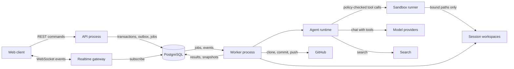
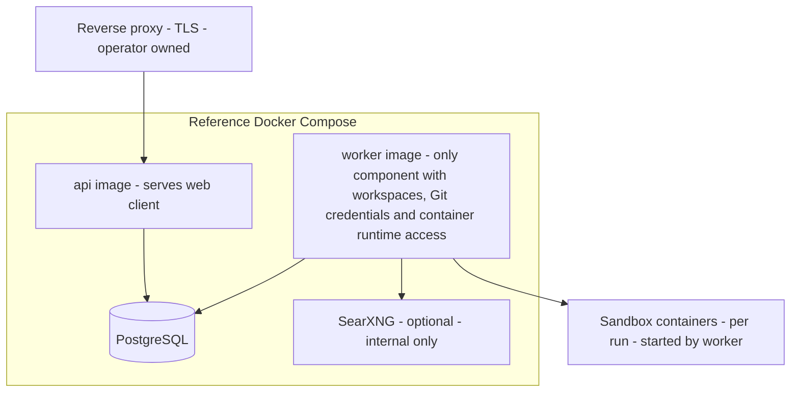

# Tandem: Component Dependencies and Communication

## 1. Dependency rules (hexagonal)
- `core` depends on nothing but the language standard library and small pure crates. No I/O, no framework types.
- `ports` depends on `core` only.
- `app` (services) depends on `core` and `ports`. It never names an adapter.
- Adapter crates depend on `ports` (and `core` types) and implement one port each.
- `api` and `worker` binaries wire adapters to services at start-up and are the only places that know concrete adapters.
- The `web` client depends only on the generated API types and the WebSocket event schema.
- Cycles between services are not allowed; cross-service coordination goes through events (see section 3).

## 2. Dependency matrix

Legend: **S** synchronous call, **J** enqueues a job, **E** publishes an event, **P** uses a port. Blank means no direct dependency.

| From \ To | C4 Identity | C7 Approval | C13 Audit | C18 Queue | C19 Events | C20 Models | C21 Search | C22 Connector | C23 Blob | C24 Vault | C25 Persist | C16 Sandbox | C17 Workspace |
|---|---|---|---|---|---|---|---|---|---|---|---|---|---|
| C2 HTTP API | S | | | | | | | | | | | | |
| C3 Realtime | S | | | | P | | | | | | | | |
| C4 Identity | | | S | | | | | | | P | P | | |
| C5 Session | S | | S | J | E | | | | | | P | | |
| C6 Thread and Messaging | S | | | J | E | | | | P | | P | | |
| C7 Approval | S | | S | | E | | | | | | P | | |
| C8 Plan | S | S | | J | E | | | | | | P | | |
| C9 Task | S | S | | J | E | | | | | | P | | |
| C10 Artifact | S | | | J | E | | | | P | | P | | |
| C11 Notifications | S | | | | E | | | | | | P | | |
| C12 Admin | S | | S | | | P | P | P | | P | P | | |
| C14 Orchestration | | S | | J | E | | | | | | P | | |
| C15 Agent Runtime | | | | | E | P | P | | | P | P | S | |
| C16 Sandbox | | | S | | | | | | | | P | | S |
| C17 Workspace | | | S | | E | | | P | P | P | P | | |

Notes:
- C2 and C3 reach every service only through C4's `authorize`; there is no unauthenticated path to domain services except sign-in and first-run setup.
- C15 depends on C16 for every tool call; there is no direct file or network access from the agent loop.
- C16 depends on C17 only to obtain the paths a run is allowed to bind; it does not call Git.
- C1 (web client) depends on C2 and C3 only.

## 3. Communication patterns

| Pattern | Used for | Why |
|---|---|---|
| Synchronous call within a process | Service to port, service to service where there is a single transaction | Simple and testable |
| Transactional outbox event | Every state change another component must react to | A reaction is never lost, and no component is called twice for one change |
| Job queue (PostgreSQL) | Anything that calls a model, Git, a runner, or takes more than a request budget | Keeps long work off the request path (NFR-3.3); survives restarts |
| `LISTEN/NOTIFY` wake-up | Telling other processes that an event or job is waiting | Cross-process fan-out with no extra service |
| WebSocket stream | Messages, presence, agent output, task status to clients | Near real-time delivery (NFR-1.4) |
| REST (JSON) | Commands and queries from the client | Standard, generated types, testable |

## 4. Data flow



Text alternative:

```text
Web --REST--> API --transactions/outbox/jobs--> PostgreSQL --jobs/events--> Worker
Web <--WebSocket--> Realtime gateway <--events-- PostgreSQL
Worker -> Agent runtime -> Model providers, Search
Agent runtime -> Sandbox runner -> session workspaces (bound paths only)
Worker -> GitHub (clone, commit, push) and session workspaces
Worker --results, snapshots--> PostgreSQL
```

## 5. Deployment view



Text alternative: a reverse proxy (run by the operator) fronts the `api` image, which also serves the web client. The `api` and `worker` images both talk to PostgreSQL. Only the `worker` image can reach workspaces, Git credentials, SearXNG and the container runtime, and it starts short-lived sandbox containers per agent run. Only the reverse-proxy entry point is exposed (SECURITY-07).

## 6. Sandbox runner boundary (decision Q4)

| Aspect | In-process runner | Container runner |
|---|---|---|
| Isolation | Server-side path confinement and tool allow-list inside the worker | OS-level: separate container, read-only root, non-root user, dropped capabilities, no network by default, CPU, memory and process limits |
| File access | Canonicalised paths checked against the run policy; traversal and symlink escape rejected | Only policy-bound paths mounted (task agents: workspace read-write; thread agents and extra repos: read-only); scratch space is temporary |
| Credentials | None available to tools | None mounted; model and Git credentials stay in the worker |
| Needs | Nothing extra | A container runtime reachable from the worker only (rootless runtime recommended); documented in the self-hosting guide |
| Failure | Denial returned to the agent as a tool error | Container fails to start: the run fails closed |

The admin sets the instance-wide policy: which runner tier is the default, the tool allow-list, network rules and resource limits (assumption X5). Policy changes apply to runs started after the change.
