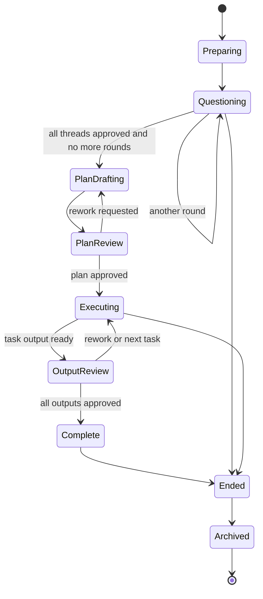
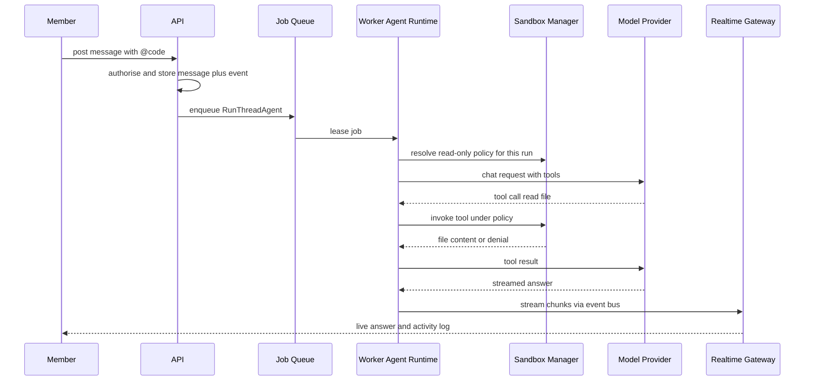
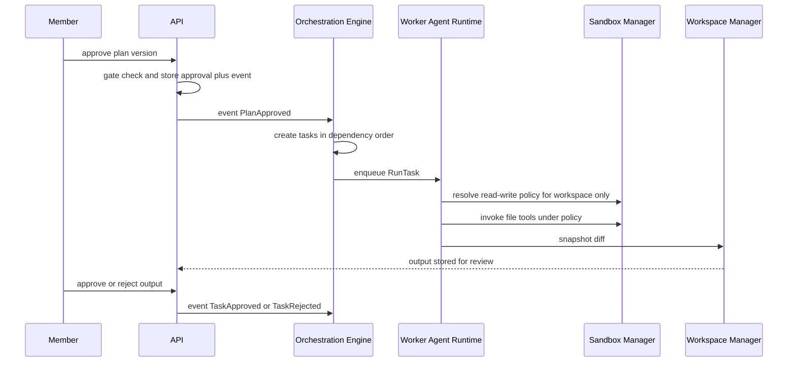

# Tandem: Services and Orchestration

## 1. Service definitions

Services are the application-layer use cases (C4 to C13) plus the worker's job handlers. They are plain Rust types over ports; the API and the worker both link them.

| Service | Runs in | Responsibility | Collaborates with |
|---|---|---|---|
| Identity and Access (C4) | api | Authentication, MFA, roles, the central `authorize` check | Persistence, Vault, Audit |
| Session (C5) | api | Session and membership commands, overview reads | Persistence, Workspace job, Audit |
| Thread and Messaging (C6) | api, worker | Threads, messages, uploads, chat | Persistence, Blob, Event Bus |
| Approval (C7) | api | The single gate service for threads, plan and task output | Persistence, Audit, Event Bus |
| Plan (C8) | api, worker | Plan versions and validation | Persistence, Event Bus |
| Task (C9) | api, worker | Task state and output snapshots | Persistence, Event Bus |
| Artifact (C10) | api, worker | Versioned artifacts | Persistence, Blob |
| Notification and Presence (C11) | api, worker | Notifications, unread, presence | Persistence, Event Bus |
| Admin and Settings (C12) | api | Providers, defaults, search, connectors, sandbox policy | Vault, Audit, Provider and Search and Connector ports |
| Audit (C13) | api, worker | Append-only security log | Persistence |
| Orchestration (C14) | worker | State-machine driver and proposal validation | Queue, Event Bus, all domain services |
| Agent Runtime (C15) | worker | Agent loop and tool layer | Provider port, Sandbox Manager, Search port |
| Sandbox (C16) | worker | Policy resolution and runners | Workspace Manager, container runtime |
| Workspace (C17) | worker | Git workspaces, commit, push, cleanup | Connector port, Vault, Blob |

## 2. Orchestration pattern

All coordination follows one pattern so gates cannot be bypassed and restarts are safe.

1. **Command**: a human action reaches the API. The service authorises it, applies it in one database transaction, and writes a **domain event to an outbox table in the same transaction**.
2. **Event**: the outbox row is published (in-process, plus `NOTIFY` so other processes wake). Publishing is at-least-once; consumers are idempotent.
3. **Decision**: the Orchestration Engine reads the event, asks the pure state machine in `core` which transitions are allowed, and enqueues zero or more **jobs**.
4. **Job**: a worker leases the job, runs it (model call, workspace operation, task), and writes results back through the same services, which emit new events.
5. **Proposal rule**: any model output is parsed into a typed proposal (questions, outcome summary, plan, task output) and validated by code before it is stored. Model output never changes state directly.

```text
Human command -> API service (transaction + outbox event) -> Orchestration decision
-> job (worker) -> result through services -> new event -> UI update via Realtime Gateway
```

### Job kinds
| Job | Triggered by | Handler |
|---|---|---|
| `PrepareWorkspace` | Session created | C17 |
| `ProposeQuestions` | Workspace ready, or another round requested | C14 then C15 |
| `SummariseThread` | Thread approval requested | C14 then C15 |
| `DecideNextRound` | Round fully approved | C14 then C15 |
| `DraftPlan` | No further round needed, or rework requested | C14 then C15 |
| `RunThreadAgent` | `@` mention | C15 |
| `RunTask` | Plan approved and dependencies approved | C15 via C16 |
| `SnapshotOutput` | Task finished | C17 or C10 |
| `CommitAndPush`, `OpenPullRequest` | Member action | C17 |
| `SaveArtifactToWorkspace` | Member action | C17 |
| `CleanupWorkspace` | Session ended | C17 (retried until it succeeds) |

## 3. Lifecycle state machine (owned by code)



Text alternative:

```text
Preparing -> Questioning (loops for extra rounds) -> PlanDrafting -> PlanReview
PlanReview -> PlanDrafting (rework) or Executing (plan approved)
Executing <-> OutputReview (rework or next task) -> Complete -> Ended -> Archived
Ended can also be reached from Questioning and Executing by owner action (with discard confirmation)
```

Thread, task and plan have their own small machines (`open/approved/reopened`, `queued/running/needs_review/approved/failed`, versioned `draft/approved/superseded`); their rules are detailed in Functional Design.

## 4. Key flows

### F1. Start a session and open the first round
1. Owner calls `create_session` (C5). The session is stored as `Preparing` and a `PrepareWorkspace` job is enqueued.
2. C17 clones the repo to an isolated worktree (or creates a managed folder). On success the session moves to `Questioning`; on failure the user sees a clear error and no half-built session remains.
3. `ProposeQuestions` runs; C14 validates the proposal and calls `open_round`, creating one thread per question.

### F2. Approve a thread
1. A member calls `approve` (C7). The service checks membership, thread state and that the actor is human.
2. The thread becomes `approved` in one transaction; an event requests `SummariseThread`.
3. The summary is posted as agent-written until the approver confirms or edits it; when every thread in the round is approved, `DecideNextRound` runs.

### F3. Call a thread agent



Text alternative: the member posts an `@code` message; the API authorises and stores it and enqueues a job; the worker resolves a read-only policy, calls the model, runs each tool call through the Sandbox Manager (which allows or denies by policy), and streams the answer to the member through the Realtime Gateway.

### F4. Approve the plan and run tasks



Text alternative: after the plan is approved, the orchestrator creates tasks in order; each task runs in the worker with a workspace-only read-write policy, its diff is snapshotted into the database for review, and a member approves or rejects it, which drives the next transition.

### F5. Commit and end
1. A member calls `commit_and_push`; C17 commits to the session branch and pushes using a short-lived credential from C22. The API never sees the credential.
2. The owner calls `end_session`. If uncommitted changes exist, explicit confirmation is required. The session moves to `Ended` and `CleanupWorkspace` deletes all clones, retrying until it succeeds.

## 5. Failure behaviour (RESILIENCY-10, SECURITY-15)
- A failed or stuck job is retried with backoff and then dead-lettered; the task shows `failed` with a reason and can be retried.
- If the orchestrator or a provider is unavailable, state stays where it is; humans can still discuss and approve.
- If the sandbox cannot start under the required policy, the run fails closed; it never falls back to a looser tier.
- Provider, search and GitHub calls use timeouts, retries and circuit breaking in their adapters, and surface a specific degraded-service message.
