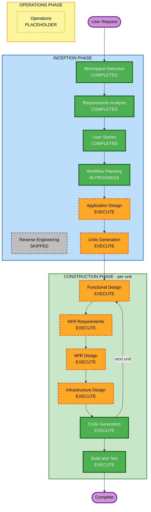

# Execution Plan: Tandem

**Stage**: INCEPTION - Workflow Planning
**Inputs**: `requirements.md` (approved), `personas.md` and `stories.md` (approved, PR #1)

## Detailed Analysis Summary

### Transformation Scope
Not applicable (greenfield).

### Change Impact Assessment
- **User-facing changes**: Yes. The whole product is user-facing: a web client with sessions, threads, plan and task review, artifacts and admin screens (84 stories, 4 personas).
- **Structural changes**: Yes. A new system with a web client, a Rust API server, a real-time channel, an agent runtime with a job queue, a Git workspace manager, a connector interface and PostgreSQL storage.
- **Data model changes**: Yes. New schema for users, sessions, threads, messages, approvals, plans (versioned), tasks, artifacts (versioned), workspaces, providers, connectors, notifications and the audit log.
- **API changes**: Yes. New REST and WebSocket interfaces, a model-provider adapter interface, a search interface and a connector interface.
- **NFR impact**: Yes. Security Baseline (SECURITY-01 to 15) and Resiliency Baseline (product scope) are enabled; real-time delivery, untrusted-agent containment and self-hosting packaging drive design.

### Risk Assessment
- **Risk level**: High. New system, multi-user real-time messaging, LLM agents treated as untrusted, Git credentials and repo clones on the server, and several unknowns in agent runtime design.
- **Rollback complexity**: Easy for the project itself (greenfield, nothing deployed). Moderate for operators later (reversible migrations, rollback by image version, NFR-5.5).
- **Testing complexity**: Complex. Needs mockable model calls (NFR-7.3), real-time behaviour, workspace isolation checks and one end-to-end test of the core loop.

### Provisional Unit Candidates (to be settled in Units Generation)
These are a starting hypothesis, not a decision.
1. **Platform core**: auth, users, MFA, admin settings, secrets, audit log
2. **Collaboration core**: sessions, membership, threads, messages, approvals, real-time, notifications
3. **Agent runtime**: model-provider adapters, orchestrator, thread agents, search, job queue
4. **Workspace and connectors**: Git workspaces, GitHub connector, extra repos, commit/push/PR
5. **Plan, tasks and artifacts**: plan versions, task lifecycle, diff/artifact review
6. **Web client**: React UI over the above, mobile layout, themes
7. **Packaging and delivery**: Docker images, Compose, CI/CD, backup/restore, self-hosting guide

## Workflow Visualization



### Text alternative

```text
INCEPTION:    Workspace Detection (done) -> Reverse Engineering (skipped, greenfield)
              -> Requirements Analysis (done) -> User Stories (done)
              -> Workflow Planning (in progress) -> Application Design (execute)
              -> Units Generation (execute)
CONSTRUCTION: For each unit: Functional Design -> NFR Requirements -> NFR Design
              -> Infrastructure Design -> Code Generation (then the next unit)
              After all units: Build and Test
OPERATIONS:   Placeholder
```

## Phases to Execute

### INCEPTION PHASE
- [x] Workspace Detection (COMPLETED)
- [x] Reverse Engineering (SKIPPED, greenfield)
- [x] Requirements Analysis (COMPLETED)
- [x] User Stories (COMPLETED)
- [x] Workflow Planning (IN PROGRESS)
- [ ] Application Design - EXECUTE
  - **Rationale**: Many new components with no existing boundaries (API, real-time hub, orchestrator, agent runtime, job queue, workspace manager, provider/search/connector interfaces). Resiliency rule RESILIENCY-01 also asks for component criticality and dependencies to be documented here (NFR-5.9).
- [ ] Units Generation - EXECUTE
  - **Rationale**: The system is too large for one unit of work. It needs decomposition, a dependency order and a story-to-unit map so each unit can be designed and built fully before the next.

### CONSTRUCTION PHASE (per unit)
- [ ] Functional Design - EXECUTE
  - **Rationale**: New data models and non-trivial business rules: approval gates, thread/plan/task state machines, versioning, membership authorisation, workspace lifecycle.
- [ ] NFR Requirements - EXECUTE
  - **Rationale**: Security Baseline and Resiliency Baseline are enabled; NFR-1.5 leaves framework choices (front-end framework, agent runtime design) to this stage; real-time and scale-out targets need quantifying.
- [ ] NFR Design - EXECUTE
  - **Rationale**: Patterns are needed for untrusted-agent containment, secret encryption, rate limiting, retries/circuit breaking and graceful shutdown.
- [ ] Infrastructure Design - EXECUTE
  - **Rationale**: Docker images, Compose topology (app, PostgreSQL, optional SearXNG), network exposure, non-root containers, CI/CD with image signing and SBOM. Scoped to what ships with the product; operator deployment choices stay in the self-hosting guide (NFR-5.4).
- [ ] Code Generation - EXECUTE (ALWAYS)
  - **Rationale**: Planning and generation for each unit.
- [ ] Build and Test - EXECUTE (ALWAYS)
  - **Rationale**: Build, unit and integration tests, and the end-to-end core-loop test (NFR-7.1).

### OPERATIONS PHASE
- [ ] Operations - PLACEHOLDER
  - **Rationale**: Future deployment and monitoring workflows.

## Estimated Timeline
- **Total stages**: 11 remaining (2 inception, 4 design stages per unit, code generation per unit, build and test)
- **Duration**: Not estimated in calendar time. The number of units, set in Units Generation, drives the effort; a firm estimate follows once units are agreed.

## Success Criteria
- **Primary goal**: A working demo of the core loop (G1): prompt, questions, threads with agents, approval, plan, tasks, artifacts and code, all approval-gated.
- **Key deliverables**: Application design, unit definitions and story map, per-unit designs, working code and tests, Docker Compose package, CI/CD, self-hosting guide.
- **Quality gates**:
  - Security Baseline and Resiliency Baseline rules checked at each construction stage
  - Every Must story passes its acceptance checklist
  - Model calls mockable; end-to-end core-loop test passes
  - Agents cannot approve and cannot run commands (verified by tests)

## Extension Compliance (this stage)
| Extension | Status | Note |
|---|---|---|
| Security Baseline | N/A at this stage | No code or infrastructure yet; the plan makes NFR Requirements, NFR Design and Infrastructure Design mandatory so rules are applied where they bite |
| Resiliency Baseline | N/A at this stage | Same reason; component criticality is scheduled for Application Design (RESILIENCY-01) |
| Property-Based Testing | Disabled | Skipped per Requirements Analysis decision |
