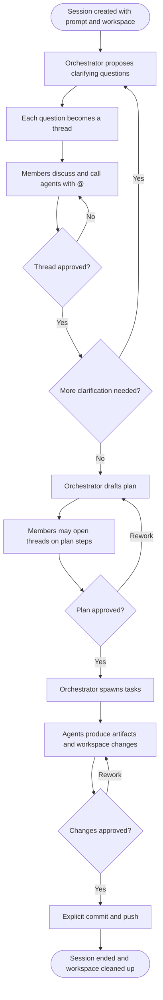

# Tandem: Requirements (MVP)

**Status**: Draft for approval
**Depth**: Comprehensive
**Sources**: `requirement-verification-questions.md` (round 1), `requirements-clarification-questions.md` (round 2),
`requirements-clarification-questions-round3.md` (round 3), `audit.md`

---

## 1. Intent Analysis

| Item | Assessment |
|---|---|
| **User request** | A self-hosted app where teams and AI agents collaborate on shared work, scoped and built with AI-DLC |
| **Request type** | New Project (greenfield) |
| **Scope** | System-wide (web client, API server, agent runtime, persistence, Git workspaces, plugin interface) |
| **Complexity** | Complex: multi-user real-time messaging, multi-level agent orchestration, BYO model providers, code workspaces |
| **Clarity (after 3 rounds)** | Clear |

### 1.1 Product summary
Tandem is an **open-source, self-hosted** workspace where a team works through a problem with AI in a
structured, Slack-like thread model. A **session** starts from a prompt. A **session orchestrator agent**
turns the prompt into clarifying questions, each discussed in its own **thread**. In a thread, people can
call **short-lived agents** with `@` mentions to research, analyse code or search the web. Each thread
closes by **approval**. Once the questions are settled, the orchestrator proposes a **plan**, which is
also approved through threads. Approved plan steps become **tasks** that agents carry out, producing
**artifacts** and/or **code changes** in the session's workspace. Nothing lands without human approval.

It is modelled on the AI-DLC process itself: questions → discussion → approval → plan → approval → build.

### 1.2 Goals
- **G1**: A working demo of the core loop: prompt → questions → threads with agents → approval → plan → tasks → artifacts/code
- **G2**: Open-weight models are first-class; any user can run Tandem fully locally (e.g. Ollama or LM Studio)
- **G3**: Easy to self-host with Docker Compose
- **G4**: Built so it can grow (more users, integrations, approval rules, org structure) without rework

### 1.3 Primary users
Any team doing shared work with AI, technical or not. MVP personas (to be detailed in User Stories):
- **Instance admin**: installs Tandem, manages users, model providers and connectors
- **Session owner**: starts a session, invites members, steers the orchestrator
- **Session member**: discusses in threads, calls agents, approves threads and plans

---

## 2. Core Concepts (glossary)

| Term | Meaning |
|---|---|
| **Instance** | One self-hosted Tandem deployment; one team for the MVP |
| **Session** | A unit of collaborative work started from an initial prompt; has members, threads, a plan, tasks, artifacts and exactly one workspace |
| **Session orchestrator** | Long-lived agent for a session: generates questions, drafts the plan, spawns and tracks tasks |
| **Thread** | A discussion on one question or plan step; people and agents post messages; closes when approved |
| **Thread agent** | Short-lived agent called with `@` inside a thread for one job (answer, analyse code, search, draft) |
| **Approval** | A human action that marks a thread (or plan) as agreed; gates every next step |
| **Plan** | The orchestrator's proposed steps for what will be built, derived from approved threads |
| **Task** | A unit of work the orchestrator spawns from an approved plan step, carried out by an agent |
| **Artifact** | A versioned Markdown document or code file produced in a session |
| **Workspace** | The session's working files: an isolated, temporary clone of a remote repo, or a managed empty folder |
| **Connector** | A plugin built on the adapter interface; GitHub is the first |
| **Model provider** | A configured source of LLMs (OpenAI-compatible, Anthropic API, or Claude Agent SDK) |

---

## 3. Session Lifecycle

### 3.1 Mermaid diagram



### 3.2 Text alternative

```text
1. Session created (prompt + workspace)
2. Orchestrator proposes clarifying questions -> one thread per question
3. Members discuss in threads, calling @agents as needed
4. Each thread is approved (or discussion continues)
5. If more clarification is needed, the orchestrator opens a new round of question threads (back to 2)
6. Orchestrator drafts a plan; members may open threads on any plan step
7. Plan approved (or reworked -> back to 6)
8. Orchestrator spawns tasks; agents produce artifacts and workspace changes
9. Changes reviewed and approved (or reworked -> back to 8)
10. Explicit commit and push; session ends and the workspace clone is deleted
```

---

## 4. Functional Requirements

### FR-1 Authentication and users
- **FR-1.1** Email + password sign-in. Magic-link sign-in is out of scope for the MVP.
- **FR-1.2** First-run setup creates the initial **instance admin** account.
- **FR-1.3** Admin can invite, deactivate and remove users. Single team per instance.
- **FR-1.4** Two instance roles: **admin** and **member**. Organisations, projects and fine-grained RBAC are post-MVP.
- **FR-1.5** TOTP multi-factor authentication: **required** for admins, optional for members (SECURITY-12).
- **FR-1.6** Users can change their password; admins can force a password reset.

### FR-2 Sessions
- **FR-2.1** Any member can create a session with a title, an initial prompt, and a workspace (FR-7).
- **FR-2.2** The creator is the **session owner** and adds members from the instance's users.
- **FR-2.3** Only session members can see a session and its contents.
- **FR-2.4** Session owner picks the models for the orchestrator and thread agents, defaulting to admin-set defaults (FR-9.3).
- **FR-2.5** Sessions have states: `active`, `ended` (read-only, workspace removed), `archived`.
- **FR-2.6** Ending a session with uncommitted workspace changes requires explicit confirmation and warns that the changes will be lost.
- **FR-2.7** A session overview shows the prompt, question rounds, thread status, plan status, tasks and artifacts.

### FR-3 Orchestrator and question rounds
- **FR-3.1** On session start, the orchestrator reads the prompt (and workspace, if a repo) and proposes a round of clarifying questions.
- **FR-3.2** Each question is opened as a thread. Questions may include suggested multiple-choice options, like AI-DLC question files.
- **FR-3.3** Members can edit, add or remove proposed questions before discussion starts.
- **FR-3.4** When all threads in a round are approved, the orchestrator decides whether another round is needed and explains why. Members can also request another round.
- **FR-3.5** The orchestrator never approves threads, the plan or changes.

### FR-4 Threads and messaging
- **FR-4.1** Slack-style thread view: messages in near real time, Markdown formatting, author (person or agent), timestamps.
- **FR-4.2** Workspace-level **session chat** channel for general discussion (people and agents).
- **FR-4.3** Threaded replies and comments on messages (Q7 A).
- **FR-4.4** Messages can reference artifacts, files and other threads.
- **FR-4.5** File uploads in threads and session chat; uploaded files become context agents can read (Q7 F).
- **FR-4.6** Presence (who is online) and unread indicators. Live co-editing cursors are out of scope.
- **FR-4.7** Each thread has a status: `open`, `approved`, `reopened`.
- **FR-4.8** When a thread is approved, the orchestrator writes a **thread outcome summary** that becomes the agreed context for later steps. Members can edit it before approving.

### FR-5 Thread agents (`@` mentions)
- **FR-5.1** Typing `@` in a thread offers agent types. MVP agent types:
  - `@ask` answers questions using thread and session context
  - `@code` analyses the session workspace and approved extra repos (read-only)
  - `@search` searches the web and cites sources (FR-10)
  - `@draft` drafts an artifact or a proposed answer for the thread
- **FR-5.2** Thread agents are short-lived: they run for one request, post their result in the thread, and stop.
- **FR-5.3** Agent output streams into the thread as it is generated and can be cancelled by the caller.
- **FR-5.4** Agent actions (tools used, files read, searches made) are shown in a collapsible activity log on the message.
- **FR-5.5** Thread agents cannot change the workspace; only tasks can (FR-8).

### FR-6 Approvals
- **FR-6.1** MVP rule: **any session member can approve a thread**, with a single approval closing it. More complex rules (N approvals, majority, per-thread rules) are post-MVP; the data model must allow them.
- **FR-6.2** Approval records who approved and when, and can be revoked (reopening the thread) until later steps depend on it.
- **FR-6.3** The plan and task outputs are approved the same way (FR-7.7, FR-8.5).

### FR-7 Plan
- **FR-7.1** After the question rounds, the orchestrator drafts a plan: numbered steps, what each step builds, expected outputs (artifacts and/or code changes), and dependencies.
- **FR-7.2** The plan is shown as a structured document with clear next steps, modelled on the AI-DLC workflow plan.
- **FR-7.3** A **member** (never the agent) can open a thread on any plan step to discuss it.
- **FR-7.4** Members can request a rework; the orchestrator revises the plan and keeps a version history.
- **FR-7.5** The plan must be approved before any task is spawned.
- **FR-7.6** Plan steps are traceable to the approved threads they come from.
- **FR-7.7** Plan approval follows FR-6.

### FR-8 Tasks
- **FR-8.1** After plan approval, the orchestrator spawns one or more tasks per plan step and runs them in dependency order.
- **FR-8.2** A task agent may: create and edit **artifacts**, and read and write **files in the session workspace**.
- **FR-8.3** A task agent **may not run commands** (no installs, builds, tests or scripts) in the MVP. Sandboxed command execution is the first post-MVP milestone.
- **FR-8.4** Task progress (queued, running, needs review, approved, failed) is shown on the session overview and in a thread per task.
- **FR-8.5** Task output is reviewed as a diff (workspace changes) or new artifact version, and approved per FR-6 before it is kept.
- **FR-8.6** Rejected output can be reworked with feedback, or discarded.
- **FR-8.7** A failed task reports why and can be retried.

### FR-9 Model providers
- **FR-9.1** Provider adapters:
  - **OpenAI-compatible API**: covers Ollama, LM Studio, vLLM, llama.cpp server, OpenRouter and OpenAI (first-class)
  - **Anthropic API** with an API key
  - **Claude Agent SDK** (optional): runs Claude Code on the server under the operator's own Claude login, for personal testing on a Pro/Max plan; draws on that account's Agent SDK credit allowance
- **FR-9.2** Admin configures providers, models and credentials once per instance and can test each connection.
- **FR-9.3** Admin sets default models for the orchestrator and thread/task agents; session owners can override per session.
- **FR-9.4** Tandem degrades clearly when a model lacks a capability (e.g. tool calling, context length) rather than failing silently.
- **FR-9.5** Billing and usage metering are out of scope (BYO models). Token usage per session is logged for visibility only.

### FR-10 Web search
- **FR-10.1** Pluggable search interface. Default: **SearXNG**, bundled as an optional Docker Compose service.
- **FR-10.2** Optional API-key providers (e.g. Brave Search, Tavily) configured by the admin.
- **FR-10.3** Search results used by agents are cited with URLs in the thread.

### FR-11 Workspaces and Git
- **FR-11.1** Every session has **exactly one primary workspace**, chosen at creation:
  - **Repo workspace**: an isolated, temporary clone of a **remote** GitHub repo, on a session-specific branch/worktree
  - **Managed folder**: an empty folder for artifact-only sessions
- **FR-11.2** Host-mounted directories and user-machine folders are **out of scope** for the MVP. A desktop helper app for local folders is planned post-MVP; server-local folders may be added later with clear security warnings.
- **FR-11.3** Workspace changes stay in the session worktree until a member explicitly **commits**. Committing creates a commit on the session branch and pushes it to the remote, so it outlives the session.
- **FR-11.4** Opening a pull request from the session branch is available through the GitHub connector.
- **FR-11.5** Access to **additional repos** is requested in a thread and granted by approval; approved extra repos are cloned **read-only** for analysis.
- **FR-11.6** Ending a session deletes its workspace clone and any extra clones (FR-2.6 confirmation applies).
- **FR-11.7** Each workspace is isolated: one session can never read another session's files.

### FR-12 Connectors (plugin interface)
- **FR-12.1** A connector/adapter interface for external tools, designed so new connectors can be added without changing core code.
- **FR-12.2** **GitHub connector** (first plugin, in MVP): authenticate (fine-grained PAT or GitHub App, admin-configured), list accessible repos, clone, push session branches, open pull requests.
- **FR-12.3** Connector credentials are stored encrypted and never exposed to the browser or to model prompts.

### FR-13 Artifacts
- **FR-13.1** Artifacts are Markdown documents or code files, stored per session with full **version history**.
- **FR-13.2** Rendering: Markdown with code syntax highlighting and Mermaid diagrams.
- **FR-13.3** Members can view, diff between versions, edit (Markdown source) and download artifacts.
- **FR-13.4** Artifacts record who (person or agent/task) created each version.
- **FR-13.5** Artifacts can be saved into the workspace (then committed per FR-11.3).

### FR-14 Notifications (minimal)
- **FR-14.1** In-app notifications for: mentions, threads awaiting approval, plan ready for review, task output ready for review. Email notifications are post-MVP.

### FR-15 Administration
- **FR-15.1** Admin settings: users, model providers and defaults, search providers, connectors, instance settings.
- **FR-15.2** Admin can view an audit log of security-relevant events (FR-SEC).

---

## 5. Non-Functional Requirements

### NFR-1 Technology
- **NFR-1.1** Front end: **TypeScript + React**, responsive for desktop and mobile browsers; installable as a PWA. Native apps are post-MVP.
- **NFR-1.2** Back end: **Rust** (Axum, Tokio, SQLx).
- **NFR-1.3** Database: **PostgreSQL**. Blob storage for uploads and artifacts behind an interface (local disk by default; S3-compatible later).
- **NFR-1.4** Real-time: WebSockets for messages, presence, agent streaming and task status.
- **NFR-1.5** Specific framework choices (e.g. front-end framework, agent runtime design) are confirmed in NFR Requirements / Application Design.

### NFR-2 Deployment
- **NFR-2.1** Ships as versioned Docker images with a reference **Docker Compose** file (app, PostgreSQL, optional SearXNG).
- **NFR-2.2** All configuration by environment variables and admin UI; secrets from env/files, never baked into images.
- **NFR-2.3** A **self-hosting guide** documents install, upgrade, backup/restore, TLS/reverse proxy, and the operator decisions listed in NFR-5.4.

### NFR-3 Performance and scale
- **NFR-3.1** Target for the MVP: one team (tens of users) on a single host, with message delivery typically under 500 ms on a LAN.
- **NFR-3.2** Designed to scale out later: stateless API processes, state in PostgreSQL, real-time fan-out behind an interface that can move to a message bus, and agent work run through a job queue so workers can be separated.
- **NFR-3.3** Long-running agent work never blocks the request path.

### NFR-4 Security (Security Baseline extension: enforced)
Content sensitivity is **moderate** (business-confidential). Applicable baseline rules:

| Rule | Requirement for Tandem |
|---|---|
| SECURITY-01 | TLS in transit (documented reverse-proxy setup; HSTS); encryption at rest for secrets and connector/model credentials (application-level); disk encryption guidance for operators |
| SECURITY-02 | Access logs available from the reverse proxy / app server (documented) |
| SECURITY-03 | Structured application logs with request IDs; no secrets, prompts' credentials or passwords in logs |
| SECURITY-04 | Security headers: CSP, HSTS, X-Content-Type-Options, frame-ancestors, Referrer-Policy |
| SECURITY-05 | Validation of every API and WebSocket input; size limits on messages and uploads; safe Markdown rendering (sanitised HTML, no script execution) |
| SECURITY-06 | Least privilege: containers run as non-root; DB user limited to the app schema; connector tokens scoped to the minimum GitHub permissions |
| SECURITY-07 | Compose network: only the web entry point exposed; DB and SearXNG internal only |
| SECURITY-08 | Authorisation checked server-side on every request: session membership, admin-only settings, workspace isolation |
| SECURITY-09 | Secure defaults, no default passwords, debug off in production images |
| SECURITY-10 | Dependency pinning, lockfiles, SBOM and vulnerability scanning in CI |
| SECURITY-11 | Secure design: agents treated as untrusted (prompt-injection aware); agents cannot approve, cannot run commands, and only reach tools and repos granted to the session |
| SECURITY-12 | Adaptive password hashing (Argon2id); breached-password check (offline list, optional online k-anonymity check); TOTP MFA required for admins; secure/HttpOnly/SameSite session cookies with server-side expiry; login rate limiting and lockout |
| SECURITY-13 | Signed, versioned images; integrity of uploads and artifacts (content hashes) |
| SECURITY-14 | Security audit log (logins, failed logins, admin changes, approvals, commits/pushes, repo access grants) |
| SECURITY-15 | Fail-safe defaults: errors return generic messages; agent/tool failures never bypass approval gates |

Additional AI-specific security requirements:
- **NFR-4.1** Content from the web, files and repos is treated as untrusted input to agents; tool permissions are enforced by the server, not by prompts.
- **NFR-4.2** Model provider credentials and connector tokens are never sent to the browser or included in model prompts.
- **NFR-4.3** Clear documentation of what data is sent to which model provider, per session.

### NFR-5 Resiliency (Resiliency Baseline extension: product-level scope)
Per round 3, the extension applies to **the product**, and deployment decisions belong to operators.

- **NFR-5.1** Health (`/healthz`) and readiness (`/readyz`) endpoints (RESILIENCY-06).
- **NFR-5.2** Timeouts, retries with backoff, and circuit breaking for model providers, search and GitHub; clear user-facing degraded states (RESILIENCY-10).
- **NFR-5.3** Graceful shutdown and restart without losing session state; in-flight agent jobs resume or fail cleanly and can be retried.
- **NFR-5.4** **Operator-owned decisions**, documented in the self-hosting guide rather than decided by the product: RTO/RPO and DR strategy (RESILIENCY-02, -11, -13), deployment style and topology (RESILIENCY-04, -08), incident response (RESILIENCY-15), resiliency testing (RESILIENCY-14).
- **NFR-5.5** Reversible, versioned database migrations; upgrade and rollback by image version (RESILIENCY-04).
- **NFR-5.6** Built-in backup and restore commands for the database and stored files (RESILIENCY-12).
- **NFR-5.7** Metrics endpoint (Prometheus format) and structured logs for operators to monitor (RESILIENCY-05, -07).
- **NFR-5.8** Project CI/CD: **GitHub Actions** builds, tests, scans and publishes versioned images (RESILIENCY-04). A lightweight change process for the project itself: PR review + changelog + release notes (RESILIENCY-03).
- **NFR-5.9** Component criticality and dependencies documented in Application Design (RESILIENCY-01).

### NFR-6 Usability and accessibility
- **NFR-6.1** Responsive layout usable on phones for reading, discussing and approving.
- **NFR-6.2** WCAG 2.2 AA as the target for core flows.
- **NFR-6.3** Light and dark themes.

### NFR-7 Maintainability and testing
- **NFR-7.1** Unit and integration tests for back-end services; component tests for key UI; one end-to-end test of the core loop.
- **NFR-7.2** Property-based testing: **not required** (extension disabled).
- **NFR-7.3** Model calls are mockable so tests run without a live LLM.
- **NFR-7.4** Licence: **GPL-3.0** (chosen by the owner; `LICENSE` in repo root). CI checks that every dependency's licence is GPL-3.0-compatible. Note: GPL-3.0 does not require publishing changes to a modified version offered only as a network service; AGPL-3.0 would. Recorded for the owner's awareness.

---

## 6. Out of Scope for MVP (planned later)
- Sandboxed command execution for agents (first post-MVP milestone)
- Desktop helper app for user-machine folders; server-local folders
- Magic-link sign-in and email notifications
- Complex approval rules (N-of-M, majority, per-thread rules, AI votes)
- Organisations, multiple teams, projects, fine-grained RBAC
- Integrations beyond GitHub (Slack, Google Drive, GitLab, MCP client support, etc.)
- Rich-text (WYSIWYG) editing; HTML artifact previews; live co-editing
- Native mobile/desktop apps
- Billing and usage-based limits

---

## 7. Assumptions (confirm or correct at approval)
- **A1** "Commit" (FR-11.3) means commit **and push** to a session branch on the remote, because the clone is deleted when the session ends.
- **A2** Remote repos in the MVP are **GitHub** only (through the connector); other Git hosts come later.
- **A3** Extra repos granted in a thread (FR-11.5) are read-only; only the primary workspace is writable.
- **A4** Any session member can approve (FR-6.1), not only the session owner.
- **A5** Presence and unread indicators are in scope as part of the Slack-like experience (FR-4.6).

---

## 8. Traceability to Answers

| Requirement area | Source answers |
|---|---|
| Open-source, self-hosted | R1 Q1 (D), Q13 (C) |
| Any team type, fits existing tools | R1 Q2, R2 C1, R3 Q1 |
| Demo of core loop | R1 Q3 (A) |
| Text, code, artifacts, Markdown | R1 Q4, R2 C11 (A) |
| Orchestrator, threads, `@` agents, approvals, tasks | R1 Q5, R2 C4, C5 |
| Slack-like messaging | R1 Q6 |
| Comments, chat, file uploads | R1 Q7 (A, C, F) |
| Single team, session membership | R1 Q8 |
| Email + password | R1 Q9, R2 C6 (B) |
| Providers incl. open-weight and Agent SDK | R1 Q10, R2 C7 (A), C8 (B) |
| Mobile-friendly web | R1 Q11 (B) |
| TypeScript front end, Rust back end | R1 Q12, R2 C10 (A) |
| Docker | R1 Q13 (C) |
| Scale-ready design | R1 Q14 |
| Moderate data sensitivity | R1 Q15 (B) |
| BYO models, no billing | R1 Q16 |
| Web search | R2 C9 (C) |
| Git core, GitHub connector | R3 Q1 (A) |
| Ephemeral remote clone only | R3 Q2 |
| One workspace per session | R3 Q3 (A) |
| No command execution in MVP | R3 Q4 (C) |
| Product-level resiliency | R2 note, R3 Q5 (A) |
| Security baseline | R1 Security (A) |
| No property-based testing | R1 PBT (C) |
